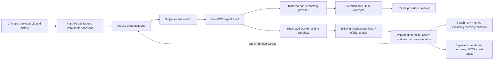

# API retry and run recovery architecture

This extends the existing single leased worker, SQLite queue and grading boundaries. It adds no broker or scheduler service. Local-v2 and official SWE-bench 5.0.2 remain distinct; official results retain `trusted_evidence=false` under local-v2 semantics.

## Request policy

New WebUI batches explicitly snapshot enabled request retries: maximum 3 total attempts, initial backoff 1 second, multiplier 2, ordinary maximum delay 20 seconds, total request/retry budget 60 seconds, jitter factor 0.5–1.0. Limits are validated (maximum five total attempts, ordinary delay at most 30 seconds, retry budget at most 180 seconds). Backoff and network time consume the original run/batch deadline. The per-profile request timeout is capped by the remaining request/run/batch budgets.

Every physical request consumes the existing `max_model_calls` allowance. `model_requests` counts logical agent operations; `http_attempts` and `http_retries` count actual transmissions. Retrying never executes an agent tool a second time. Transport buffers a complete JSON response before yielding an action; streaming is disabled, and malformed/partial streaming payloads are not replayed as successful actions.

408/429/500/502/503/504 and positively classified temporary transport faults can retry. 400/401/403/404/405/413/422, certificate failures, permanent DNS NXDOMAIN, malformed/oversized responses, revoked/disabled credentials/configuration, permanent quota and unknown exceptions fail fast. Structured quota codes and numeric wait fields are inspected; arbitrary provider message text is not matched. Retry-After (seconds or HTTP date), retry_after_ms, wait_ms and soonest_available_ms are treated as bounded relative waiting hints; the largest supplied valid wait wins. Code `quota_guard_request_too_large`, or zero eligible capacity with no known recovery time, stops retries. Only allowlisted provider codes are persisted; raw bodies/headers/messages are discarded.

Provider+endpoint cooldown is persisted on retryable failures. The queue skips blocked endpoints and deferred children, allowing other providers/fresh eligible jobs to proceed. Short waits are bounded inside a request; long waits terminate explicitly. If recovery is enabled and a whole run can fit before the unchanged batch deadline, a child can wait durably. No arbitrary long sleep or tight loop occupies the single worker.

## Run recovery and durability

Recovery defaults OFF. When enabled, at most one child is admitted for each original parentless scheduled attempt with an exhausted eligible transient API failure. Repair failure, hidden-test failure, cancellation, batch deadline, permanent quota/authentication, whole-evaluation timeout and unknown failures do not recover. Whole-run timeout recovery is deliberately unsupported.

The parent's failed terminal verdict and child insertion/recovery decision commit in the same SQLite `BEGIN IMMEDIATE` transaction. A unique `run_recoveries.parent_id`, unique child ID and primary-keyed `recovery_decisions` prevent duplicate scans/chains. A declined decision is durable and cannot later reopen a terminal batch when capacity changes. The lease must be current both for finalization and scheduling. Transaction rollback leaves neither a partial terminal decision nor an orphan child. Startup can rescan committed eligible failures; stale owners cannot schedule or mutate state. A worker interruption clears pre-commit eligibility and requires explicit retry, so recovery scanning cannot reopen an already terminal batch.

The new run copies the exact original task, model/provider/credential revisions, non-secret effective limits, dataset and grading snapshots. It receives a new run/container/patch identity and a fresh pinned checkout. Current disabling/revocation stops pending retries; rotation alone preserves the original version binding. Recovery is appended to FIFO, never prepended. Original attempt numbering and batch_attempts are unchanged; recovery membership is separate. Pending recovery prevents terminal batch derivation, and batch cancellation/deadline reaches both original and recovery jobs. Recovery completion never rewrites a failed parent's benchmark outcome.

Admission reserves all possible recovery runs and their complete HTTP caps; effective total runs must satisfy server and pending-queue bounds. Before insertion, the worker rechecks cancellation, deadline, queue capacity, provider state and request allowance. Remaining time must cover the larger of the configured minimum and the full effective per-run timeout. Recovery cannot extend deadlines or create a recursive retry chain.

## Persistence, accounting and rollout

`migrations/004_retries.sql` is an explicit additive feature migration on management schema 3: provider_cooldowns, run_recoveries, recovery_decisions and metadata `api_retry_schema=1`. It intentionally retains core `user_version=3`; normal startup does not create retry tables. `swe-eval migrate-retries` is explicit and idempotent. Retry-enabled admission requires the marker.

Already admitted jobs without a retry snapshot retain one API attempt and no recovery. New WebUI batches display their policy, possible recovery count and reservation. Optional omitted fields retain previous idempotency hashes. Retry policy participates in runtime fingerprinting; harness provenance includes the retry/transport implementation. No historical data is promoted or rewritten.

Ambiguous failures may have reached/billed the upstream. Exactly-once upstream execution is not promised. HTTP counters reserve dispatches before sending; after a process/transport interruption, upstream receipt and billing can remain indeterminate. Unknown usage/cost remains unknown across later successful requests; known response usage/cost subtotals are separate, reasoning tokens remain a completion-token subset, and currencies are never added together. Total-token enforcement requires reported complete usage and fails closed before another logical request if ambiguity prevents accounting. A recovered valid response can still produce an agent action and actual grading; it does not certify a repair.

Benchmark summaries and Pass@1 exclude automatic recovery children while preserving infrastructure-failed originals. Explicit operational fields report recovery counts/resolutions, total HTTP attempts and currency-specific known costs/unknown runs. JSON and CSV retain this distinction. Existing first-attempt, legacy, stub and official/local trust isolation remains.
