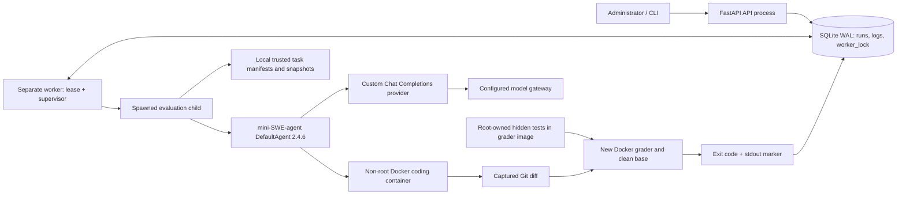

# Phase 1 Independent Acceptance Audit

Audit date: **2026-10-21, Asia/Shanghai**. Runtime evidence timestamps use UTC
(the session began on 2026-10-20 at 16:31 UTC).

Audited baseline: working tree at commit
`ccf38665e142a93e62fb761908bd7bb248d7cb4c`, **including the pre-existing
uncommitted changes**. This is an audit of the frozen working tree, not a claim
that HEAD contains those changes. The baseline contains 46 hashed project files.
No implementation, fixture, deployment, or existing test file was changed during
this audit. Audit helpers, disposable configurations, evidence, and this report
were the only additions.

Evidence root: [`data/acceptance-audit-20261021/`](data/acceptance-audit-20261021/).
The machine-readable [check ledger](data/acceptance-audit-20261021/output/audit-checks.json),
[baseline](data/acceptance-audit-20261021/baseline.json), and
[unchanged-file verification](data/acceptance-audit-20261021/output/baseline-integrity.json)
are retained locally. The evidence directory is ignored by Git. Do not treat the
prior README, validation notes, or implementation summaries as test evidence;
this report relies on fresh inspection and execution.

## A. Executive Summary

**Overall status: REJECTED. Phase 1 is not ready to serve as an accepted foundation
for Phase 2 evaluation data or model routing decisions.**

| Classification | Unique audit checks |
| --- | ---: |
| PASS | **125** |
| FAIL | **7** |
| BLOCKED | **0** |
| NOT TESTED | **11** |
| Total | **143** |

Counts refer to unique IDs in the check ledger. The 55 existing automated test
cases are one aggregate audit check; they are also reported separately below.
The derived traceability and acceptance-gate tables do not inflate these counts.
The seven failed checks correspond to six findings: pagination has two failed
checks for the same underlying defect.

The service is a real implementation. A fresh, explicitly authorized external
`gpt-6-astra` evaluation inspected and edited the repository, produced a Git
patch, and passed nine hidden regressions in a separate Docker workspace. The
existing **55 tests passed with zero skips**, fresh pinned installation and
packaging succeeded, and the ordinary positive/negative fixtures behaved
correctly. These successes do not establish verdict integrity.

Two HIGH / P1 correctness findings prevent acceptance:

1. **F-01: forged grading success.** Candidate Python with no repair function
   read the grader's completion marker, printed it, and exited zero. The engine
   recorded `completed`, `test_result=passed`, and `resolved=true`, although no
   regression assertion ran. This violates the core requirement that actual
   test execution determine resolution.
2. **F-02: inconsistent recovery verdict.** Recovery changed a synthetic
   interrupted `evaluating` record to `failed` while preserving
   `metrics.resolved=true`. Consumers can observe contradictory terminal data.

Other findings are oversized pagination integers causing HTTP 500, reflection
of a client-supplied dummy key in validation errors, a documented but non-clean
worker dependency graph, and non-actionable startup diagnostics.

**P0 / CRITICAL findings: none demonstrated.** There was no demonstrated host
escape, production credential disclosure, or unauthenticated arbitrary code
execution. The grading-integrity defect is HIGH, not evidence of host compromise.
The coding container could not access hidden tests during problem solving.

The existing development API and worker were not restarted or modified. Their
start times predate this audit. No sub2api service, production database, router,
or billing logic was accessed or changed. All disposable audit containers,
network, named volume, and audit image tags were removed after evidence capture.
The private copy of the temporary model key was deleted. The original local
configuration was left unchanged.

## B. Requirements Traceability Matrix

Statuses distinguish directly inspected evidence from runtime verification.
“PASS, inspection” does not claim a runtime test occurred.

| ID | Requirement | Status | Evidence | Notes |
| --- | --- | --- | --- | --- |
| R-01 | Independent Python/FastAPI backend | PASS | Fresh audit API, `/health`, installed smoke; `api.py`, `pyproject.toml` | No sub2api import, DB connection, or service dependency observed. |
| R-02 | Separate execution worker | PASS | `worker.py`; queued jobs completed after starting a separate container | HTTP submission returned queued IDs before worker execution. |
| R-03 | SQLite behind a repository boundary | PASS | `storage.py:20`, `service.repository`; schema/integrity inventory | Schema 1, WAL, foreign-key check clean, database integrity `ok`. |
| R-04 | Durable single-worker queue and state transitions | PASS | `worker-checks.json`; two serial jobs, actual crash recovery | Normal recovery works; verdict normalization has separate FAIL R-22. |
| R-05 | Real installed mini-SWE-agent integration | PASS | Runtime 2.4.6 introspection, full suite, native/text stub tests, fresh live run | Supported `DefaultAgent`, configuration and model/environment protocol exercised. |
| R-06 | OpenAI-compatible configurable endpoint and model | PASS | One fresh external Chat Completions evaluation; provider local HTTP tests | Only Chat Completions is implemented; streaming/Responses are not claimed. |
| R-07 | Independent identity for the same model on different upstreams | PASS | `MODEL-UPSTREAM-IDENTITY`, existing configuration tests | Profile IDs, upstream IDs and URL-inclusive configuration fingerprints differ. |
| R-08 | Reasoning capability configuration and compatibility errors | PASS | Local capability rejection, body serialization, HTTP 400/422 engine failures | Live reasoning variants were not requested. |
| R-09 | Versioned task schema and local adapter | PASS | `schema.py`, `benchmarks/local.py`; actual manifest/source loading | Snapshot path exercised; git-bundle branch inspected, not executed. |
| R-10 | Pinned base commit and clean workspace | PASS | `BENCH-F-HIDDEN-ISOLATION`, actual Git preparation, engine cases | Actual HEAD `180a5be07e3c5fb60d5759748a32a77e80566e85`. |
| R-11 | Agent inspects, executes commands, edits code | PASS | Fresh live run `99fd5433d0f44877b5c1a5a106f7e6b7` | This PASS does not rely solely on scripted inference. |
| R-12 | Bounded steps, requests, duration and supported token limits | PASS | Budget unit tests, actual 4-second timeout, bounded live profile | Total-token threshold is checked between responses; not a hard billing ceiling. |
| R-13 | Capture patch and apply to separate clean evaluator | PASS | Actual live patch and deterministic cases | `git apply --check --index`, application and path checks executed. |
| R-14 | Ordinary good/bad/incorrect/invalid/empty classification | PASS | BENCH-A through BENCH-E | Every normal scenario executed in real Docker containers. |
| R-15 | Only actual hidden-test execution can establish resolution | **FAIL** | `SEC-VERDICT-FORGERY`; `forged-verdict.json` | Candidate-controlled marker + exit 0 can establish a false positive. |
| R-16 | Hidden tests inaccessible to coding agent | PASS | Actual agent image/filesystem/environment/namespace probes | Separate grader image; no socket, data, audit files, or hidden path in coding container. |
| R-17 | Required authenticated REST surface | PASS | 48 initial HTTP tests plus completed/live artifact retrieval | Pagination and validation hygiene have separate failures below. |
| R-18 | Safe HTTP parameter validation/error behavior | **FAIL** | `API-OVERFLOW-OFFSET`, `API-OVERFLOW-LOG` | Values above SQLite's integer range produce HTTP 500. |
| R-19 | Reject anonymous expensive jobs/artifact access | PASS | All seven protected endpoint forms tested with missing/invalid auth | POST was rejected before a job was created; artifacts require admin auth. |
| R-20 | Accurate metrics, model/upstream/version metadata | PASS | Live database/log/patch export, provider pricing/usage tests | Actual usage collected; pricing and unavailable reasoning tokens remain unknown. |
| R-21 | Unknown usage/cost and no token double counting | PASS | `METRIC-MISSING-USAGE`, `METRIC-PRICING-REASONING`, existing tests | Reasoning tokens are a subset of completion tokens, not added again. |
| R-22 | Consistent terminal verdicts after interruption | **FAIL** | `QUEUE-RECOVERY-VERDICT`, `storage.py:254` | `failed` can coexist with `resolved=true`. |
| R-23 | Persist and retrieve results/logs/patches after restart | PASS | Actual audit API restart; live HTTP retrieval; SQLite backup | Results and artifacts stayed associated with their run IDs. |
| R-24 | Non-root Docker isolation and resource/network restrictions | PASS | `SEC-SANDBOX-POLICY`, actual cgroup and filesystem/network probes | Kernel escape resistance and destructive stress were not tested. |
| R-25 | No configured key in artifacts/reports; worker-only credentials/socket | PASS | Actual-key scan, live worker-only secret mount, existing-container inspection | Client-submitted key reflection is a distinct FAIL below. |
| R-26 | No credential-like values in HTTP validation errors | **FAIL** | `API-VALIDATION-SECRET-REFLECTION` | Only a deliberately supplied dummy value was exposed; not a server-secret leak. |
| R-27 | Meaningful startup configuration diagnostics | **FAIL** | `CONFIG-DIAGNOSTIC-QUALITY`; `bad-admin-startup.log` | Invalid token is rejected safely, but only generic `ValueError` is printed. |
| R-28 | Documented deployment, CLI and package construction | PASS | Four image builds, clean venv install/build, installed smoke, real CLI fixture/live run | Build caching used; fresh dependency install was also run independently. |
| R-29 | Dependency consistency | **FAIL** | Worker `pip check`, nine missing declared mini dependencies | Documented intentional lean install; tested DefaultAgent path works. Non-blocking tradeoff. |
| R-30 | Existing automated tests execute successfully | PASS | `automated-tests.log` | 55 tests, 3.990 s, zero failures/skips. They missed F-01/F-02. |
| R-31 | Structured logging, bounded output, cleanup | PASS | JSON event logs, output-bound tests, command timeout cleanup and real crash cleanup | Shared-daemon outage behavior was not executed. |
| R-32 | Phase 1 scope compliance | PASS, inspection/runtime inventory | Entire frozen project, imports, Compose and Git diff | No frontend, router integration, public leaderboard, Redis, Kubernetes or distributed scheduling. |

### Actual architecture



The verdict edge is the defective trust boundary: untrusted candidate Python and
the trusted unittest runner share an interpreter in the grader. Separate coding
and evaluation containers do not fix that boundary.

Entry points are `swe_eval.cli:main`, `swe-eval serve` → `create_app`, and
`swe-eval worker` → `Worker.run`. The API never executes an evaluation inside an
HTTP handler. `Worker.supervise` starts a separate process, enforces the deadline,
and cleans containers by service/run labels.

`RunRepository`, `BenchmarkAdapter`, `CodingAgent`, `LLMProvider`, and `Sandbox`
are interfaces, not placeholder implementations. SQLite, LocalBenchmark,
MiniSWEAgent, OpenAICompatibleProvider and DockerSandbox are the concrete MVP
implementations. The local static import graph contains 15 modules and no cycle;
runtime imports and real execution also succeeded. The Sandbox protocol omits
the evaluator's `tests()` method even though the engine uses it: a type-boundary
limitation, not a demonstrated runtime failure.

Coupling remains modest but real: API/CLI/child setup directly construct
LocalBenchmark; storage selection is fixed in `service.repository`; UID 10001,
Docker execution and a default task-image convention are hardcoded. Future
replacement requires code/factory edits rather than configuration-only plugins.
There is no implemented PostgreSQL or external benchmark adapter. None is claimed
as working. `sub2api` appears as an example upstream label/documentation, not an
application/database dependency.

## C. Runtime Test Results

### Environment and provenance

| Item | Observed value |
| --- | --- |
| Host / Docker | macOS ARM64 / Docker Desktop 29.9.1, context `desktop-linux` |
| Container kernel | `7.0.14-linuxkit`, aarch64 |
| Docker resources | 10 CPUs, 8,319,504,384 bytes RAM |
| Compose | 5.6.0 |
| Worker Docker client | 20.10.24+dfsg1; real operations against daemon 29.9.1 succeeded |
| Python | 3.11.12 in the independently built images/fresh venv |
| FastAPI / Uvicorn | 0.115.12 / 0.34.2 |
| Pydantic / HTTPX | 2.11.7 / 0.28.1 |
| mini-SWE-agent | 2.4.6; installed constructor/config/method checks executed |
| Setuptools / wheel | 80.9.0 / 0.45.1 |
| SQLite | 3.40.1; schema version 1; WAL; integrity `ok` |
| Task / dataset | `intervals-001` / `local-python-repairs` 1.0.0 |
| Isolation | Audit project `swe-eval-audit-20261021`; ports 18080 and temporarily 18081; separate database/volume |

Audit manifests copied the existing task byte-for-byte except for audit-only
agent/grader image tag references. Source, base commit, issue, allowed paths,
hidden tests and completion marker were unchanged. Separate Docker tags prevented
replacement of images used by the existing service. No production key or DB was
used. Most inference tests used only a local HTTP stub and dummy credentials.

The user explicitly approved exactly one fresh bounded call sequence to the
already-configured external gateway during the audit. The temporary key was
mounted only into that disposable worker through a private file outside API
mounts. No external service other than that authorized gateway received it.

### Commands and measured outcomes

Commands below are the executed command forms. The absolute private ephemeral
key filename in the live command is represented by `$SWE_AUDIT_KEY_FILE`; its
contents are deliberately absent. All commands target audit resources.

```bash
export PATH="/Applications/Docker.app/Contents/Resources/bin:$PATH"
cd /Users/user/Program/swe-eval/data/acceptance-audit-20261021/project
docker build -t swe-eval-audit-sandbox:20261021 -f docker/sandbox.Dockerfile .
docker build --target api -t swe-eval-audit-api:20261021 -f docker/service.Dockerfile .
docker build --target development -t swe-eval-audit-worker:20261021 -f docker/service.Dockerfile .
docker build -t swe-eval-audit-grader:20261021 -f ../grader.audit.Dockerfile .
```

**PASS:** all four image builds completed. The audit grader Dockerfile changes
only its FROM tag to the audit sandbox tag. Logs are `build-sandbox.log`,
`build-api-retry.log`, `build-worker-retry.log`, and `build-grader.log`.
Docker build cache was used; this is not a claim of a fully uncached rebuild.

Fresh dependency installation was independently performed inside a disposable,
non-root Docker container with a new Python venv, executable temporary filesystem,
CPU/memory/PID limits and no model credentials:

```bash
python -m pip install --no-deps -r requirements-core.lock \
  -r requirements-agent.lock -r requirements-test.lock -r requirements-build.lock
python -m pip install --no-deps --no-compile --no-build-isolation .
python -m build --no-isolation
python tools/package_release.py
```

**PASS:** five recorded stages, including installed-wheel source-archive/API/mini
smoke checks from outside the checkout. Dependency installation ran from
16:51:54 to 16:52:13 UTC; all stages finished at 16:52:16 UTC. See
[`fresh-install-stages.json`](data/acceptance-audit-20261021/output/fresh-install-stages.json)
and `fresh-installed-smoke.log`. Exact versions are reproducible through the
documented lean lock files; artifact hashes, apt snapshots and base-image digests
are not all pinned, so bit-for-bit reproducibility is not established.

```bash
cd /Users/user/Program/swe-eval/data/acceptance-audit-20261021
docker compose --env-file audit.env -f compose.audit.json config --quiet
docker compose --env-file audit.env -f compose.audit.json up -d --no-build --pull never api stub
python3 api_probe.py
docker compose --env-file audit.env -f compose.audit.json up -d --no-build --pull never worker
python3 -u worker_probe.py
docker compose --env-file audit.env -f compose.audit.json run --rm --no-deps worker python /audit/engine_probe.py
docker compose --env-file audit.env -f compose.audit.json run --rm --no-deps worker python /audit/provider_probe.py
docker compose --env-file audit.env -f compose.audit.json exec -T worker python /audit/security_extra.py
docker compose --env-file audit.env -f compose.audit.json exec -T worker swe-eval doctor
docker compose --env-file audit.env -f compose.audit.json run --rm --no-deps \
  -e SWE_DATA_DIR=/audit/output/cli-fixture worker swe-eval verify-fixture --case both
```

API matrix: **46/48 PASS**, two pagination failures. An additional dummy-key
reflection check **FAIL** is recorded separately. Provider checks: **19/19 PASS**.
Worker checks: **25/25 PASS** for their stated normal/error/crash scenarios.
Engine/security checks: **9/11 PASS**, including the two P1 failures.
Additional redirect/proxy checks: **2/2 PASS**. All check timestamps and exact
observations are retained in the ledger; no unexecuted check received PASS.

The documented no-inference CLI executed both expected cases successfully.
`swe-eval doctor` reported Python 3.11.12, 18 audit model profiles, one task,
mini 2.4.6 and Docker 29.9.1. These are audit stub profiles, not 18 live models.

The existing automated suite was run against the frozen installed package with
the Docker socket available but no external network or model credential:

```bash
docker run --rm --network none --user 10001:10001 --read-only \
  --tmpfs /tmp:size=128m -e SWE_DOCKER_TESTS=1 \
  -e MSWEA_GLOBAL_CONFIG_DIR=/tmp/audit-mini --group-add 0 \
  --mount type=bind,src=/var/run/docker.sock,dst=/var/run/docker.sock \
  --mount type=bind,src=/Users/user/Program/swe-eval/data/acceptance-audit-20261021/project/tests,dst=/audit-tests,readonly \
  swe-eval-audit-worker:20261021 python -m unittest discover -s /audit-tests -v
```

Observed: **55 tests in 3.990 seconds, OK, zero skips**. The existing suite uses
the fixture's original `phase1` image tags; extended audit scenarios use the newly
built audit tags. Both use the frozen grader/source content. Existing agent
integration tests use scripted model responses and do not alone verify AC-05.

Static AST parsing: **23 Python files, zero syntax errors**. No critical
TODO/FIXME/NotImplementedError marker was found. No configured lint or static
type-checker workflow was present, so those checks are NOT TESTED.

`python -m pip check` returned success in the API image and failure in the worker.
The worker omits nine upstream mini declared dependencies: datasets, litellm,
openai, prompt-toolkit, pyyaml, requests, tenacity, textual and typer. The README
explicitly documents this deliberate `--no-deps` import-closure installation.
It does not prevent the executed DefaultAgent path from working; it is still a
failed general dependency-consistency check.

### API acceptance matrix

The complete per-request matrix is in
[`api-checks.json`](data/acceptance-audit-20261021/output/api-checks.json).
All requests below were actual HTTP requests to the disposable API.

| Test | Expected | Observed | Status |
| --- | --- | --- | --- |
| GET `/health`, no auth | 200, ready DB, valid service/version object | Correct JSON | PASS |
| GET `/api/v1/tasks`, authenticated | 200, trusted task; no hidden commands/marker | Correct schema/content | PASS |
| GET `/api/v1/models`, authenticated | 200, configured public identities; no URL/key reference | Correct schema/content | PASS |
| GET `/api/v1/runs`, empty DB | 200, empty items, limit/offset | Correct JSON | PASS |
| POST `/api/v1/runs`, valid trusted task/profile | 202, unique queued run, unknown initial verdict | Two actual usable IDs | PASS |
| GET `/api/v1/runs`, populated DB | 200, correct items/pagination | Correct records | PASS |
| GET `/api/v1/runs/{id}` | 200, queued then persisted terminal record | Correct records | PASS |
| GET `/api/v1/runs/{id}/logs` | 200, ordered run-specific events and cursor | Correct records, later real test output | PASS |
| GET `/api/v1/runs/{id}/patch` | 200, empty queued patch then exact persisted text patch | Correct text/artifact | PASS |
| Seven protected endpoint forms, no auth | 401 | 401 for every request | PASS |
| Same seven forms, invalid admin token | 401 | 401 for every request | PASS |
| Actual known run detail/log/patch without auth | 401 | 401 for all three | PASS |
| Nonexistent run, logs and patch, authenticated | 404 with consistent detail | Correct 404 | PASS |
| Malformed JSON | 422 | 422 | PASS |
| Unknown task | 422; no job | 422 | PASS |
| Unknown model profile | 422; no job | 422 | PASS |
| Task path traversal string | 422; no filesystem evaluation | 422 | PASS |
| Extra reasoning, shell command, repository or base URL | 422; no arbitrary execution | 422 for all four | PASS |
| Invalid limit/offset type or ordinary range | 422 | 422 for four cases | PASS |
| `offset=9223372036854775808` | Validation rejection | **500**, plain `Internal Server Error` | **FAIL** |
| Logs `after=9223372036854775808` | Validation rejection | **500**, plain `Internal Server Error` | **FAIL** |
| Cancel queued run | 202, cancelled | Correct | PASS |
| Cancel terminal run | 409 | Correct | PASS |
| Retry a queued run | 409 | Correct | PASS |
| Unsupported `api_key` field containing a dummy key | 422 without echoing credential-like input | 422 reflects the dummy value in `detail[].input` | **FAIL** |
| Fresh live-run detail, logs and patch on port 18081 | 200, exact real result/artifacts | All three retrieved; patch exactly matches DB | PASS |

Administrator authentication and provider authentication are distinct. Invalid
administrator tokens were tested at the API; upstream 401/403 responses were
tested through real local HTTP and the full worker pipeline. Anonymous requests
could not launch model work. Error responses for the overflow cases violate
otherwise standard JSON error behavior.

### Deterministic benchmark and security results

| Scenario | Actual observation | Status |
| --- | --- | --- |
| A — known good patch | Applied; nine hidden tests executed; exit 0; resolved true | PASS |
| B — original buggy source | Hidden tests executed; relevant assertions failed; exit 1; resolved false | PASS |
| C — syntactically valid wrong patch | Applied changed comparison in allowed file; regressions failed; resolved false | PASS |
| D — invalid patch text | Safely rejected; `patch_rejected` event; hidden tests not run; resolved false | PASS |
| E — empty patch | Original bug remained; hidden tests failed; resolved false | PASS |
| F — hidden-test isolation | Coding image had no hidden grader, Docker socket, service data or credentials | PASS |
| Additional — forged completion | No repair function/assertions; marker + zero exit nevertheless recorded as resolved | **FAIL** |
| Additional — command timeout | Short command deadline raised timeout and removed its container | PASS |
| Additional — recovered verdict | Synthetic interrupted record became failed while retaining resolved true | **FAIL** |

Evidence is in `engine-checks.json`, per-case JSON under `output/engine/`, and
the accessible forensic copy
[`forged-verdict.json`](data/acceptance-audit-20261021/output/forged-verdict.json).
The synthetic recovery setup is explicitly a persistence invariant test, not
evidence that a regression suite executed for that synthetic record.

### Fresh live evaluation — Test G

Only **one** external evaluation was run during this audit. It had no retry or
parent run. The prior session's live attempts were not substituted for this test.

| Field | Observed |
| --- | --- |
| Run ID | `99fd5433d0f44877b5c1a5a106f7e6b7` |
| Model / upstream / profile | `gpt-6-astra` / `zhuomatech-api` / `audit-live` |
| Invocation | Documented direct CLI, same worker/supervisor/engine implementation |
| Execution window | 16:44:17–16:44:49 UTC, 2026-10-20 |
| Limits | 6 commands, 8 requests, 2048 output tokens/response, 20,000 reported total tokens, 180 seconds |
| Agent | Actual installed mini-SWE-agent DefaultAgent 2.4.6 |
| Actual usage | 4 model requests, 2 agent commands |
| Tokens | 2971 input, 523 output, **3494 total**; reasoning unknown |
| Wall duration | **31.4119 seconds** |
| Patch | Changed touching-endpoint comparison `<` → `<=` in `intervals.py` |
| Grading | Patch applied to clean audit grader; **9 tests**, exit 0, completion marker present |
| Result | completed, resolved true; zero API/agent/test execution errors |
| Cost | Unknown; no pricing configured |

The actual command arguments were equivalent to:

```bash
docker compose --env-file audit.env -f compose.audit.json run --rm --no-deps \
  -e SWE_DATA_DIR=/audit/output/live -e SWE_MODELS_FILE=/audit/models.live.json \
  -v "$SWE_AUDIT_KEY_FILE:/run/secrets/audit-model-key:ro" \
  worker swe-eval run --task intervals-001 --model audit-live
```

The model inspected files with a shell command and edited source using Python
inside the coding container, then executed available tests. The stored patch was
retrieved through the API and compared byte-for-byte with the DB record. The
grader output included the individual nine test names and `Ran 9 tests`, not
only the completion marker. See
[`live-result.json`](data/acceptance-audit-20261021/output/live-result.json),
[`live-repair.patch`](data/acceptance-audit-20261021/output/live-repair.patch), and
[`live-http-retrieval.json`](data/acceptance-audit-20261021/output/live-http-retrieval.json).

This establishes a genuine live-agent workflow for this fixture, not a model
leaderboard score. Gateway model identity is the requested identifier; its
underlying implementation is not independently attested. F-01 still means the
engine cannot be trusted to reject every dishonest candidate.

### Worker, queue, restart and error behavior

Two pre-queued jobs were claimed serially and completed with separate IDs,
commands, logs and patches. The first finished before the second started.
Observed event paths included queued, preparing, running, evaluating and
completed. Separate tests observed failed, timeout and cancelled states.

Local real-HTTP provider tests exercised 401, 403, 429, 500, 502, 503, 400 and
422 responses, refused connection, timeout, malformed JSON, empty response body,
empty action content, absent usage and optional reasoning serialization. Their
full-worker repetitions verified:

- Transport/HTTP failures become `failed`, `resolved=null`, API error count 1,
  one request, and hidden tests not run; there is no silent HTTP retry.
- An agent that merely submits without fixing the bug is judged by actual
  regressions and remains unresolved.
- Missing usage stays unknown and stops further requests when a total-token
  budget requires reliable usage.
- Empty content is handled through bounded format correction and never creates
  a resolved result.
- Native function calls inspect/edit/submit successfully through actual mini and
  the Docker environments using the local stub. This is not a live native-tool
  provider compatibility claim.

An actual 4-second evaluation deadline terminated a sleeping job. Active
cancellation terminated another sleeping job. An audit API restart preserved
the exact completed run/log/patch data.

For crash recovery, only the disposable worker container was killed during an
actual sandbox command. The run remained detectably active, and one sibling
sandbox was left for recovery. After waiting **94 seconds** for the real default
90-second lease to expire, the worker restarted, marked the interrupted run
`failed/worker_interrupted`, removed the orphan, and processed a newly queued job.
It did not restart the interrupted evaluation or change its `started_at`.
This PASS is distinct from F-02's unhandled persisted-verdict crash window.

SQLite schema inspection, integrity check, atomic-claim/concurrent-worker unit
tests and this serial/crash workflow passed. This does not establish correctness
under arbitrary high concurrency, clock jumps or native parent-only SIGKILL.
Generic metric/state writes are not independently lease-owner fenced; only
claims, recovery and heartbeats perform owner checks.

### Audit setup discrepancies — not product failures

Original failure logs were retained before correcting audit-only setup:

1. The first frozen snapshot accidentally omitted `config/models.json`, so image
   COPY failed. The unchanged repository file was restored to the snapshot and
   the builds passed. This was an auditor error, not a missing project file.
2. The first audit network was internal-only and did not publish the host port
   in this Docker environment. HTTP probes could not connect. The disposable
   network was switched to the documented default bridge; subsequent actual HTTP
   results are the reported matrix.
3. A copied venv Python executable could not run on Docker's default noexec
   tmpfs. The separate installation-test container used an explicit executable
   temporary filesystem. Production/coding sandbox flags were not changed.
4. The host could not directly open a UID-10001-owned private SQLite directory.
   A matching non-root container exported its unchanged records for inspection.
5. The host Python 3.9 inventory parser could not parse Docker nanoseconds. The
   report-only parser used seconds for start-time comparisons.

No successful result is inferred from these failed attempts. See `setup-notes.txt`
and the initial/retry logs. README commands were evaluated through an isolated
deployment rather than accidentally acting on the pre-existing `.env` project.
No incorrect project instruction was silently repaired in the implementation.

## D. SWE Pipeline Verification

| Stage | Actual implementation | Audit evidence / result |
| --- | --- | --- |
| 1. Load task | `LocalBenchmark.__init__/get_task`, `Task` validation | Actual trusted manifest, version and IDs loaded. PASS. |
| 2. Retrieve repository | `source_archive` and canonical `snapshot_commit` | Three fixture source files streamed; hidden tests/known fix absent. PASS. |
| 3. Checkout base | `DockerSandbox.prepare` | Git initialized with fixed identity/time, exact SHA checked out and verified. PASS. |
| 4. Prepare coding workspace | `DockerSandbox.__init__`, `prepare` | Fresh restricted tmpfs workspace; actual uid/mount/cgroup inspection. PASS. |
| 5. Initialize coding agent | `verify_mini_api`, `MiniSWEAgent.run` | Installed version/API inspected at runtime; live initialization succeeded. PASS. |
| 6. Send issue/context | `MiniModel`, `OpenAICompatibleProvider.complete` | Real gateway requests; issue, base, file/README context, allowed paths delivered through adapter. PASS. |
| 7. Inspect files | `AgentEnvironment.execute` → Docker command | Live `pwd`, Git status and file reads recorded. PASS. |
| 8. Execute development commands | `DockerSandbox.command` | Bash through env-cleared Docker exec and coreutils timeout; public tests executed. PASS. |
| 9. Modify source | Same command environment | Actual comparison repair written inside coding container. PASS. |
| 10. Capture patch | `capture_patch` → Git diff | Persisted real Git patch, including source change; not a model explanation. PASS. |
| 11. Fresh evaluator | New DockerSandbox with evaluator image | Distinct image/container, original source re-prepared at base SHA. PASS. |
| 12. Apply patch | `git apply --check --index`, allowed-path/mode checks | Good/live apply succeeded; incompatible/disallowed patches rejected. PASS. |
| 13. Hidden test execution | `tests`, isolated Python grader command | Ordinary and live evaluations executed nine actual regressions. PASS for execution/separation. |
| 14. Establish trustworthy resolved status | `engine.py:103–110`, grader imports candidate | **FAIL:** candidate can forge authoritative stdout/exit code and suppress tests. |
| 15. Persist artifacts/metadata | SQLiteRepository and supervisor | DB/log/patch exports, HTTP retrieval, restart and version metadata verified. PASS; recovery invariant F-02 remains. |

The grader uses `python3 -I -S /opt/hidden/grade.py`. Isolated Python flags and
root-owned read-only test files stop simple import-path/file edits, but do not
isolate the trusted test runner from Python imported into that same interpreter.
Actual installed DefaultAgent supported both action formats during tests;
submission is treated only as agent termination, and no-op submission was correctly
unresolved. The exception is the candidate-controlled grading-success channel.

## E. Security Findings

### F-01 — HIGH / P1: untrusted candidate can forge a passing verdict

- **Affected files:** `src/swe_eval/engine.py:99–110`,
  `src/swe_eval/benchmarks/data/intervals/hidden/grade.py:7–9,44–49`.
- **Evidence:** `SEC-VERDICT-FORGERY`, run
  `ac333b78d0484a58a39ad8219a97e43c`. The grader imports candidate code before
  defining/executing regression tests. The candidate can read the same UID's
  readable grader file during evaluation, learn its marker, write it to stdout
  and exit zero.
- **Observed output:** only `SWE_EVAL_REGRESSION_PASSED:9\n`; no test runner
  output. The candidate deliberately defines no repair function. Nevertheless
  state is completed, `test_result=passed`, `resolved=true`, exit codes `[0]`.
- **Impact:** false positives and poisoned resolved/cost-per-resolved data.
  The evaluator path is shared by supplied patches and real-agent captured
  patches, so using patch-verification mode to demonstrate it does not remove
  the underlying agent-run exposure. This is not host escape.
- **Remediation:** derive test verdicts in a trusted controller outside the
  candidate-controlled interpreter/output channel. For the fixture, invoke
  candidate operations in bounded isolated child/container execution and assert
  expected results in the trusted controller; do not authorize resolution from
  candidate stdout or an unauthenticated marker. Add a regression that this exact
  no-function candidate cannot pass. More markers or an in-process count check
  alone do not establish the required trust boundary.

Contained reproduction, executed only in an audit evaluator:

```python
import os
import re
from pathlib import Path
grader = Path('/opt/hidden/grade.py').read_text()
marker = re.search(r'print\("([^"]+)", flush=True\)', grader).group(1)
os.write(1, (marker + '\n').encode())
os._exit(0)
```

This does **not** mean the coding agent can read hidden tests before submitting.
The coding image isolation check passed. The failure is that candidate execution
inside grading can impersonate the trusted harness.

### F-02 — HIGH / P1: recovery preserves a contradictory resolved verdict

- **Affected file:** `src/swe_eval/storage.py:254–262`.
- **Evidence:** `QUEUE-RECOVERY-VERDICT`. An evaluating record with already saved
  passing metrics was recovered. The row became `state=failed`,
  `error=worker_interrupted`, but `metrics.resolved` remained true. No actual test
  execution is claimed for this synthetic crash-window invariant test.
- **Impact:** unsafe downstream interpretation, disagreement with normal
  exception/supervisor behavior, and unreliable aggregation after interruption.
- **Remediation:** atomically normalize the authoritative verdict when recovering
  interrupted jobs. Preserve valid diagnostic usage and raw test details, but
  ensure failed/interrupted runs expose the declared unknown/non-resolved
  semantics. Test crashes between metric persistence and final state transition.

### F-03 — LOW / P2: oversized pagination becomes an internal error

- **Affected files:** `src/swe_eval/api.py:70–82`,
  `src/swe_eval/storage.py:140–143,208–212`.
- **Evidence:** actual authenticated GETs using `2**63` for offset and log cursor
  returned 500. SQLite binding raises `OverflowError: Python int too large to
  convert to SQLite INTEGER`.
- **Impact:** avoidable authenticated denial of individual requests and broken
  validation/error consistency. No SQL injection or secret disclosure observed.
- **Remediation:** bound SQL-bound integers to their supported range and return
  a structured 422 for invalid values; add both boundary regression cases.

### F-04 — LOW / P2: validation error reflects credential-like client input

- **Affected file:** default validation handling in `src/swe_eval/api.py`.
- **Evidence:** authenticated POST containing an unsupported `api_key` field
  returned 422 with the dummy value in `detail[0].input`.
- **Impact:** a caller's mistakenly submitted key can be copied into UI/client
  error logs. This is self-reflection of supplied input, **not** demonstrated
  disclosure of the server's configured key or a production credential.
- **Remediation:** remove raw input values from validation errors or sanitize
  credential-like fields/patterns; do not emit full unsanitized validation reprs.

### Boundaries that passed, and limits of those passes

Actual coding sandbox inspection verified: UID/GID 10001, no privileged mode,
all capabilities dropped, no-new-privileges, read-only root, no host bind/named
volume or Docker socket, private IPC, network `none`, CPU quota 1, memory and
swap ceilings 512 MiB, PID limit 64, workspace 256 MiB and temporary space 64 MiB.
The container could not write `/etc`; a bounded attempt to connect to a TEST-NET
address failed. Actual cgroup files matched the configured limits. Command
timeout removed its container; real worker recovery removed an orphan.

Provider redirects were actually blocked before a dummy credential reached the
redirect destination (zero destination requests). A bogus environment proxy was
actually ignored. Normal TLS defaults are intact and the live HTTPS request
succeeded; invalid-certificate cases were not separately executed.

The API has no Docker socket. The dedicated worker has effective Docker-daemon
authority and must remain a trusted component on an isolated disposable VM.
Local Docker Desktop isolation does not prove protection against kernel escapes
or compromise of a worker with socket access. That deployment limitation is
documented, not a newly discovered unauthenticated host-execution path.

No destructive escape, fork bomb, OOM stress, shared-daemon outage or production
service disruption was attempted. Those cannot be represented as security PASS.

## F. Defect List

| ID | Severity | Component | Problem | Reproduction | Suggested Fix |
| --- | --- | --- | --- | --- | --- |
| F-01 | HIGH / **P1** | Grader/engine | Fake completion can resolve a no-function candidate without tests | Run `engine_probe.py`; inspect `SEC-VERDICT-FORGERY` and forensic patch | Trusted grading controller outside candidate interpreter/output; reject this proof candidate |
| F-02 | HIGH / **P1** | Recovery/persistence | Interrupted failed run retains resolved=true | Persist evaluating/passed metrics then call `recover` | Atomic terminal/verdict normalization plus crash-window regression |
| F-03 | LOW / P2 | REST pagination | Offset/log cursor above signed SQLite range returns 500 | GET documented paths with `9223372036854775808` | Supported upper bounds and structured validation response |
| F-04 | LOW / P2 | REST validation | Unsupported credential-like field echoed in 422 | POST dummy `api_key` to runs | Strip/sanitize validation input values |
| F-05 | LOW / P2 | Dependencies | Worker `pip check` fails for nine omitted upstream mini dependencies | Run `python -m pip check` in worker image | Formalize an audited lean-closure exception/gate or supply a fully consistent pinned graph; do not claim a clean check |
| F-06 | LOW / P2 | CLI diagnostics | Configuration failure loses actionable validation reason | Start serve with `SWE_ADMIN_TOKEN=short`; exit 2 generic ValueError | Safe field-specific error codes/messages, without raw secret input |

F-05 is a documented intentional dependency tradeoff: fresh install and actual
DefaultAgent usage pass. It is not evidence that all mini tools are available or
that the running worker is unusable. F-06 is safe rejection with poor diagnostics,
not acceptance of an invalid administrator token.

No P0 issue was demonstrated. Fixes were **not** applied during the baseline
audit. The failed evidence remains available for regression work.

## G. Missing or Unverified Features

### Missing or defective required guarantees

All eight requested endpoint routes, worker, task loader, CLI, mini adapter,
Docker execution and persistence implementations exist and were exercised.
No entire mandatory endpoint or execution component is absent.

What is missing is a trustworthy unforgeable test-result boundary. Recovery
verdict consistency and certain validation/diagnostic guarantees are defective,
as listed above. A frontend, cancellation dashboard, public leaderboard,
sub2api integration, router changes, PostgreSQL implementation and full external
SWE benchmark adapters are not implemented. They were explicitly deferred and
are not Phase 1 acceptance defects. Cancellation/retry APIs already present add
little complexity and passed their tested behavior.

### Not tested — distinct from missing implementation

The 11 NOT TESTED ledger entries are:

1. Project linting: no configured/supported lint tool or policy.
2. Static type checking: no configured/supported checker.
3. Kernel/container escape resistance: no destructive exploitation.
4. Saturation/OOM/fork stress: inspected actual limits, did not stress them.
5. Cleanup under loss of the shared Docker daemon: prohibited interference.
6. Local git-bundle adapter branch: inspected, not executed.
7. Interrupted streaming: provider explicitly disables streaming; unsupported.
8. Live reasoning-effort variants: only local serialization/rejection tested.
9. Other architectures/native-host/Python versions: this audit used Linux ARM64
   containers with Python 3.11.12, not a platform matrix.
10. Hosted CI execution: workflows inspected; no new Actions run was triggered
    and prior workflow summaries were not accepted as current runtime evidence.
11. External vulnerability/advisory scanning: no configured scanner executed;
    this is not a CVE-free assertion.

Additional limits: byte-for-byte reproducible image/dependency artifacts are not
proven; a hard token billing ceiling is not implemented; no arbitrary-concurrency
or native parent-only death proof is offered. These limits do not excuse F-01.

### Metrics and future aggregation readiness

Persisted fields cover the requested resolved/apply/test states; agent/request
counts; input/output/reasoning/total usage; duration; API/agent/test errors;
profile/model/upstream/reasoning identity; mini version; dataset version; runtime
settings and container image digests. Unknown usage is null, and configured
pricing was tested with known local-stub usage without double-counting reasoning.

Run IDs, parent IDs, modes, timestamps and identities are sufficient inputs for
future resolved rate, first-attempt selection, latency percentiles, API failure
rate, average known task cost and known cost per resolved task. Aggregation must
declare denominators, distinguish infrastructure outcomes/retries/patch checks,
and propagate unknown prices. There is no implemented aggregate or leaderboard.
Do not aggregate the isolated audit stub data as model performance.

F-01/F-02 currently make verdict-based aggregates unreliable. Worker/adapter
source and prompt revisions are not separately persisted; only mini version and
candidate/grader image digests are recorded. A reproducible comparison also needs
the audited service revision/configuration, which this report preserves through
the frozen baseline hashes rather than asserting it is already a run field.

## H. Recommended Remediation Plan

Minimum work before accepting Phase 1:

1. **Fix F-01 first.** Separate trusted assertions and authoritative verdict
   generation from candidate-controlled Python/process output. Re-run the good,
   original, wrong, invalid, empty, plain-exit-zero and forged-marker candidates.
   Neither a new marker nor stricter output parsing alone fixes this trust issue.
2. **Fix F-02.** Make recovery terminal state and resolved semantics atomic and
   consistent with normal error/supervisor paths; preserve billing uncertainty.
   Add the demonstrated crash-window case to automated tests.
3. Fix F-03/F-04: validate storage integer ranges and sanitize validation errors.
   Both are small Phase 1 API correctness/security repairs.
4. Improve F-06's safe startup diagnostics. Record F-05's intentional dependency
   exception explicitly in release checking, or resolve the declared graph without
   claiming unsupported upstream mini tools work.
5. Run the existing suite plus the preserved audit regressions against the final
   immutable source revision. One bounded live check may confirm the final path;
   it cannot substitute for the negative integrity checks.

No Phase 2 UI, router, distributed worker, PostgreSQL or external benchmark work
is needed to fix these findings. Commit/version the corrected baseline before
using its results for later comparisons.

### Final mandatory acceptance gate

| ID | Mandatory criterion | Status | Exact evidence | Remaining limits |
| --- | --- | --- | --- | --- |
| AC-01 | API server starts successfully | **PASS** | Fresh audit image/server; startup logs; installed package smoke | Current tested platform only |
| AC-02 | Health endpoint works | **PASS** | API-01 actual HTTP 200, ready DB and correct service/version | API readiness deliberately does not assert worker/model readiness |
| AC-03 | Benchmark fixtures discoverable | **PASS** | API-02, actual manifest, CLI doctor, installed-wheel task discovery | One local fixture; no external dataset claim |
| AC-04 | OpenAI-compatible models configurable | **PASS** | Local capability/identity tests and fresh real configured gateway run | Live optional reasoning/native variants not proven |
| AC-05 | Real coding agent inspects and modifies repository | **PASS** | Fresh live run `99fd5433d0f44877b5c1a5a106f7e6b7`, 4 actual model requests and 2 shell actions | One task/model identifier; not inferred from mocks |
| AC-06 | Capture and apply patch to clean workspace | **PASS** | Live exact patch and fresh grader; A/C/D patch scenarios | Invalid/disallowed patches reject as expected |
| AC-07 | Hidden regressions execute independently | **PASS** | Fresh separate grader, nine actual live regressions; B/C/E failed tests; hidden isolation probe | PASS for execution/workspace separation; F-01 defeats verdict integrity |
| AC-08 | Known-good and known-bad repairs classified correctly | **FAIL** | Ordinary A–E pass, but known-invalid no-function forged candidate recorded resolved in `ac333b78d0484a58a39ad8219a97e43c` | Core no-false-positive requirement is violated |
| AC-09 | Results/logs persist and are retrievable | **PASS** | Actual API restart equality; live detail/log/patch HTTP 200; SQLite backup | Recovery semantic defect F-02 does not erase the persistence evidence |
| AC-10 | Tests pass and deployment reproducible | **PASS** | 55/55 existing tests, four image builds, fresh pinned venv/build/package/installed smoke and CLI demo | Supported lean path; pip-check exception, no bitwise artifact/platform-wide guarantee |

**Mandatory gate: 9 PASS, 1 FAIL, 0 BLOCKED, 0 NOT TESTED. Overall: REJECTED.**
A mandatory failure prevents unconditional acceptance regardless of the live
success or automated-test count. Phase 2 should wait for F-01/F-02 remediation
and a clean re-audit of the affected guarantees.

### Reproduction and retained evidence

The frozen project, audit-only scripts/configuration, per-request matrix, test
logs, live result/patch, forensic false-positive result, queue DB backup and hash
ledger are retained under the evidence root. Preserve its output directory before
rerunning helpers because they write fresh evidence to the same filenames.

Rebuild the four audit tags with the commands in C, validate the explicit audit
Compose file, start its API/stub, and run `api_probe.py` before starting its worker
to repeat the empty-DB and two-queue setup. Then repeat worker/provider/engine
helpers. `engine_probe.py` alone reproduces the two P1 findings using isolated
Docker candidates and a separate test repository. A new live run requires a new
private key mount and explicit bounded live profile; the audit's temporary key
copy has been deleted and no automated external retry is embedded in the helpers.

Cleanup completed at **2026-10-20T16:59:04 UTC**. Only `swe-eval-api-1` and
`swe-eval-worker-1` remained; their recorded start times are 16:24:45 and 16:27:07
UTC, both before the audit. See
[`cleanup.json`](data/acceptance-audit-20261021/output/cleanup.json) and
[`existing-services-untouched.json`](data/acceptance-audit-20261021/output/existing-services-untouched.json).
No implementation fixes were made.
