# Phase 1.5 Remediation Report

Date: 2026-10-21 (Asia/Shanghai). Evidence timestamps are UTC.

All six original findings have been addressed in the working tree. No Phase 2
feature, sub2api change, production credential change, or production database
migration was made. This is a tested working tree, not a claim that the changes
have been committed, pushed, or run in hosted CI.

The original [acceptance report](PHASE1_ACCEPTANCE_REPORT.md) is unchanged.
Original forensic evidence under `data/acceptance-audit-20261021/` remains intact.
New evidence is isolated under [`data/remediation-20261021/`](data/remediation-20261021/).
The initial Git status, diff and file hashes are in `before/baseline.json` and
`before/baseline.diff`. Pre-existing unrelated edits were preserved.

## Before-fix evidence

New regression tests ran against the unchanged implementation before repairs.
[`before/failing-regressions.log`](data/remediation-20261021/before/failing-regressions.log)
records **5 test methods with 8 failed assertions/subtests**:

- Exact F-01 exploit: a no-function candidate was recorded as resolved.
- F-02: an interrupted record became failed while retaining resolved=true.
- F-03: both overflowing pagination paths returned HTTP 500.
- F-04: a dummy key was echoed in a validation response.
- F-06: startup diagnostics omitted the invalid configuration setting.

F-05's original nine missing declared dependencies were inspected in the prior
`pip-check-worker.log`; the unchanged pinned graph was also reproduced in
`before/pip-check.log`. No clean `pip check` result is claimed for a lean worker.
An initial local harness lacked FastAPI; dependencies were installed into a new
isolated virtualenv before the actual before-fix regression run.

## Findings, root causes and repairs

| Finding | Root cause | Before | Corrected behavior | Regression evidence |
| --- | --- | --- | --- | --- |
| F-01, HIGH/P1 | Candidate import shared the grader interpreter; stdout marker and exit code authorized success | No function, no assertions, resolved=true | Separate candidate and controller containers; trusted assertions compare untrusted operation values; candidate output cannot authorize a verdict | Exact original exploit, forged old/new output, complete forged controller JSON, forced exits/signals/import exceptions, malformed values; all blocked on final images |
| F-02, HIGH/P1 | Recovery changed state without normalizing metrics; state/metrics finalization were separate writes | failed + resolved=true; stale metric/patch writes possible | Terminal state and normalized resolution committed in one transaction; failed/timeout/cancelled/interrupted resolution null; terminal records immutable; active writes require a valid lease | Crash windows, rollback injection, completion/recovery race, expired lease, stale state/metrics/patch writes; real worker crash/recovery |
| F-03, LOW/P2 | Unbounded Python integers reached SQLite bindings | 2**63 produced HTTP 500 | Offset and log cursor constrained to 0..2**63-1; invalid values receive structured 422 | Negative, fractional, noninteger, upper-bound and oversized values on both routes |
| F-04, LOW/P2 | Default request validation serialized raw input | Client dummy credential echoed in 422 | Validation includes location/type/message, omits input/context/body; authentication errors omit credentials | Dummy API keys/passwords/bearer/header values, malformed JSON, response and log scans |
| F-05, LOW/P2 | Intentional mini import-closure install had no enforceable compatibility exception | Raw pip check failed without a release gate | Explicit option B exception; exact missing-requirement allowlist, pinned mini version/API imports, Docker/CI enforcement; any additional drift fails | Actual image gate, supported mini actions, exact/extra/missing/version-drift gate tests |
| F-06, LOW/P2 | CLI replaced safe validation explanations with exception class only | Generic ValueError; no setting identified | Dedicated secret-free ConfigurationError names SWE_ADMIN_TOKEN/SWE_MODELS_FILE and corrective guidance; exit 2 | Missing/short/placeholder admin tokens, missing/malformed/invalid model files; final API container startup |

## Trusted grading boundary

```mermaid
flowchart LR
    Mini[mini DefaultAgent] --> Coding[Coding container: no hidden files]
    Coding --> Patch[Git patch]
    Patch --> Candidate[New clean evaluation candidate container]
    Controller[Trusted controller container: hidden assertions] -->|operation inputs| Worker[Trusted worker relay]
    Worker -->|inputs only| Candidate
    Candidate -->|untrusted JSON values and diagnostics| Worker
    Worker -->|observations| Controller
    Controller -->|independently checked assertion verdict| Engine[Engine / atomic SQLite finalization]
```

The evaluation candidate uses the same **hidden-free image** as the coding
container. It starts from the pinned clean repository and receives the patch.
The controller uses the grader image but receives **no candidate source, patch,
workspace, mounts, or executable objects**. It has separate PID/IPC/network and
filesystem namespaces. Neither container has a socket, service data, or secrets.

The worker relays nine input operations. A root-owned operation runner imports
candidate Python only inside the candidate container. Its stdout is an untrusted
JSON operation value; stderr is diagnostic. Candidate code may corrupt that
interpreter, exit, raise or signal it; none of those operations controls the
controller interpreter or its hidden expected answers.

All nine original hidden scenarios and their expected outcomes are preserved:
touching, transitive, disjoint adjacency, nesting, duplicates, negative endpoints,
empty input, input preservation, and invalid reversed ranges. Input preservation
has two comparisons, giving **ten trusted assertions** across nine cases.
The controller independently checks and counts these comparisons. JSON verdict
accounting is validated by the sandbox boundary before the engine consumes it.
The original test scenarios were migrated to this independent operation protocol,
not removed from the acceptance conditions.

The engine separately records patch application, operation exits, test execution
errors, expected/executed/passed assertions, test result and final resolution.
The old `success_marker` remains only for manifest compatibility; the engine
never reads it to determine success. A printed old marker, invented marker, or
complete new-format verdict JSON is not a valid operation result and cannot pass.

A failed assertion is a completed unresolved evaluation. An operation that cannot
produce a valid result is a test-execution error, with failed/null resolution.
Patch rejection is completed/unresolved without running tests. The deadline
covers the entire operation sequence. Candidate diagnostics and trusted case
failure details remain available to authenticated administrators.

## Terminal-state integrity

`transition(..., metrics=...)` now writes state, error, timestamps and normalized
metrics atomically. `recover()` performs the same normalization within its
recovery transaction. Diagnostic fields, including recorded usage and test
observations, survive recovery; only incomplete resolution authority is removed.
Unknown usage remains null.

The engine no longer writes metrics after committing a terminal state. The
supervisor finalizes only active rows and does not overwrite a child's finalized
verdict. Expired leases cannot mutate active rows. Recovered terminal records
reject stale metrics, patches and transitions. Retries retain a new child ID.

Recovery commits the failed/null record before removing orphan containers.
Cleanup is an external Docker side effect, not part of a SQLite transaction.
Worker acquisition waits for cleanup before claiming subsequent queued work.
This ordering was verified; the retained audit timing observation is explained in
the [re-acceptance report](PHASE1_REACCEPTANCE_REPORT.md).

## Dependency decision

**Option B retained intentionally.** Installing the full upstream graph would
add unused dataset, general provider and interactive stacks. The service
uses DefaultAgent and its own provider/environment implementations. Exactly nine
upstream requirements are excluded:

`datasets`, `litellm`, `openai`, `prompt-toolkit`, `pyyaml`, `requests`, `tenacity`,
`textual`, `typer`.

Upstream dataset loading, mini interactive/CLI interfaces, LiteLLM/OpenAI provider
adapters and related features are unsupported in this installation. All current
lock versions are preserved. The new gate verifies raw pip check fails for
**exactly** those requirements, then verifies the supported installed mini API.
It prints `pip_check=FAILED_EXPECTED`. A clean core/API graph is checked separately.
Both CI workflows and the worker Docker build enforce the exception. This is a
resolved compatibility-policy finding, not a claim that missing upstream
requirements have been installed or that raw pip check succeeds.

## Files changed by this remediation

Relative to the preserved working-tree baseline:

- `src/swe_eval/sandbox.py`, `candidate_runner.py`, `engine.py`: independent
  controller/candidate execution and trusted assertion metrics.
- `src/swe_eval/benchmarks/data/intervals/hidden/grade.py`, `task.json`:
  preserved regression cases using the isolated operation protocol.
- `src/swe_eval/schema.py`: grading protocol and assertion accounting fields.
- `src/swe_eval/storage.py`, `worker.py`: atomic terminal invariants, recovery and
  stale-write fencing.
- `src/swe_eval/api.py`: pagination bounds and secret-free validation responses.
- `src/swe_eval/config.py`, `cli.py`: safe actionable startup diagnostics.
- `src/swe_eval/dependency_check.py`: explicit lean dependency release gate.
- `docker/sandbox.Dockerfile`, `grader.Dockerfile`, `service.Dockerfile`: runner
  installation, configurable sandbox base for isolated audit builds, dependency gate.
- `tests/test_remediation.py`: **15 new test methods**, including attack subcases.
- `tests/test_docker_integration.py`: optional audit image overrides; existing
  tests and assertions retained.
- `.github/workflows/build-package.yml`, `test.yml`: dependency gate enforcement.
- `README.md`: actual corrected boundary, compatibility policy and reproduction.
- This report and `PHASE1_REACCEPTANCE_REPORT.md`.

The agent/provider implementations, fixture source/base SHA, known repair,
existing core/API/mini tests, lockfiles, normal Compose topology and pre-existing
unrelated changes are unchanged from the audit baseline. See
[`source-provenance.json`](data/remediation-20261021/output/source-provenance.json).
No implementation changes were made to mask the later audit observations.

## Verification and limitations

- **70/70 automated tests passed on the final installed Linux worker image;
  zero skips.** The original 55 tests remain.
- **48/48 real HTTP API checks passed.** Boundary and secret tests also ran as
  automated ASGI tests, with response/log scanning.
- Exact original exploit failed against the installed final image and actual
  Docker pipeline. All twelve negative integrity candidates stayed non-resolved;
  the positive hidden-access probe passed ten assertions.
- Deterministic good/original/wrong/invalid/empty, isolation, provider errors,
  pricing/usage, queue, cancellation, timeout, persistence and real crash tests ran.
- The exact production worker target passed its CLI fixtures, doctor and queued
  mini-agent repair using a local HTTP stub. No new paid/external model call occurred.

Remaining limits are explicit: finite functional tests cannot prove behavior on
unseen inputs; Docker shares its kernel; the trusted worker's socket authority
requires a disposable worker VM. Native macOS worker timeout verification hit
host signal permissions in this managed session and is not accepted as a working
native deployment here; the supported verified worker runtime is Linux Docker.
The original services remain running their old images until separately upgraded.
Legacy marker-era results are not silently regraded or rewritten; fresh v2 runs
must be used for integrity-verified comparisons. No external benchmark adapter,
frontend, router integration, or Phase 2 feature was introduced.

Final operations note: no audit mutation targeted the original services, but a
read-only final inspection observed one automatic restart of the existing worker
at 21:46 UTC. Its cause is undetermined. The re-acceptance report preserves both
start-time snapshots and does not claim unchanged worker uptime.
