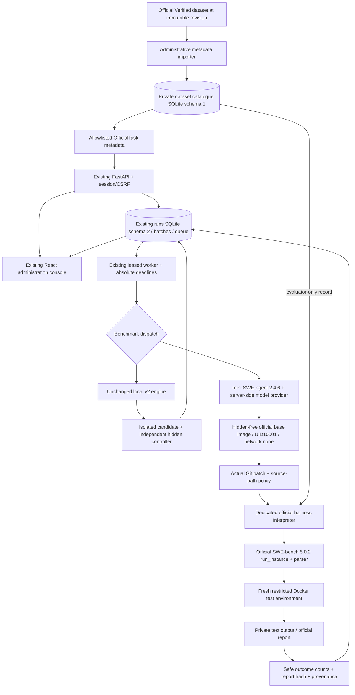

# Phase 2.6 SWE-bench architecture

This extends SWE Evaluation Center. It is an isolated implementation bundle under
`data/phase26-swebench-20261021T135404Z/project/`; **no Phase 2.6 source promotion or existing-service
restart has been performed**. The shared checkout and port 8000 remain Phase 2.5.

## Verified baseline

Git HEAD: `ccf38665e142a93e62fb761908bd7bb248d7cb4c`, plus the preserved dirty tree.
The required Phase 2.5 reports were read completely. Its promoted application,
frontend and tests matched the accepted source manifest with zero differences.
`baseline.json` records selected SHA-256 hashes and Git status. The accepted
installed baseline executed 109 tests, all passing, before implementation.
Previous Phase 1/1.5/2/2.5 reports and forensic directories are preserved.

## Components and boundaries

The API does not receive a Docker socket. Only trusted administrative preparation
and workers have daemon control. Coding/test containers receive no daemon socket,
model key, host data bind, catalogue, service database, or reference solution.
Model requests remain in the worker's existing provider boundary.

`benchmarks/official.py` implements a private Catalogue, public OfficialTask, and
TaskRegistry combining local and official tasks. `official_harness.py` is the
worker-side subprocess adapter; `swebench_bridge.py` runs only in
`/opt/swebench/bin/python`. `official_engine.py` shares the existing queue,
supervisor, model provider and agent while selecting the official grader.
The local grader is not used to score official tasks.

## Versioned identity

* Dataset: `SWE-bench/SWE-bench_Verified`, revision `78f471bf655a3137b2e8a75af1501690ec009ec3` (500 metadata rows).
* Harness: SWE-bench 5.0.2, commit `02e7a74ffd0b707aab73d203fe87bdc7c76afc8e`.
* Task-definition repository inspected at `3d07b464b7b311a0cbfb5ed5b2d8a3b96f84a33d`.
* Local protocol remains `swe-eval-grading-v2`.
* Official protocol is **`swebench-official-v5`**, with a separate evidence authority.
* Subset: `curated-20-v1`, explicitly an internal subset rather than a full score.

Task IDs contain the complete dataset commit plus official instance ID. Each
private record has an immutable source-content hash. Importing changed bytes at
the same revision/instance aborts the transaction. Older revisions remain indexed.
Subset membership and its hash are immutable per revision.

Run snapshots retain dataset/repository/base commit, subset, agent version,
harness version/commit and local adapter hash, model/profile/upstream/endpoint,
reasoning/limits, image digest, task and configuration fingerprints. Results add
candidate patch SHA-256, official run ID, report SHA-256, execution configuration
fingerprint and failure classification. A nonce plus run/patch/configuration hash
prevents both replay cache reuse and cross-patch collisions.

## Persistence

The accepted runs database remains schema 2. Dataset administration creates a
**separate explicit** `datasets/catalogue.sqlite3` schema 1, with immutable
instances, append-only validation observations, and versioned subsets. Ordinary
API startup/listing does not create or migrate that catalogue. The importer is an
operator CLI, not an HTTP endpoint accepting arbitrary datasets or scripts.

Gold/test patches, expected test IDs, scripts, hints and private configuration
are never fields of OfficialTask or queue task JSON. They exist only in the
private catalogue/import/evaluation directory. The bridge gets a single private
record, emits an allowlisted ordinary summary, and retains raw artifacts privately.
The protected parent directory is 0700; catalogue/request files are 0600. Protect
all backups and evidence as operator-only data, outside any web static root.

## Upstream compatibility and security

Installed v5 CLI help was exercised for `swebench`, `dataset check`, `eval` and
`report`. Upstream exposes the expected `--gold`, `-p`, `-i`, `--run-id`, `-j`,
`--task-repo` options. Real grading uses its Python `run_instance` implementation,
not a fabricated report. That module-level interface and the callback bindings
are a **version-pinned compatibility shim**; upgrade requires re-auditing it.
Critical upstream modules are checked against bundled hashes before evaluation.
No large upstream implementation was copied into this project.

Upstream defaults add SYS_ADMIN and have no equivalent platform resource policy.
The shim substitutes container creation and bounded transport, preserving upstream
patch application, evaluation script and report/parser semantics. It enforces
network none, read-only root, drop ALL/no-new-privileges, 1 CPU, 2 GiB RAM/no extra
swap, 256 PIDs, no host mounts, and bounded tmpfs (1 GiB repository, 128 MiB tmp,
16 MiB root home). Output is bounded to 8 MiB, repository transfer to 256 MiB;
an outer process deadline handles a silent/hung test stream. Cleanup uses service
and run labels and remains fail-closed if daemon state cannot be confirmed.

Coding uses the accepted DockerSandbox at UID10001 with a pinned official image,
a pristine checkout at base_commit, and no network or hidden materials. Patch
precheck occurs in another clean coding box: only regular source-file changes,
no traversal, test/runner/build configuration, .git or new symlinks. Gold patch
path review of the selected 20 found no gold source paths outside this policy.
The policy is intentionally conservative for future instances.

**Trust limitation:** official grading installs private tests in the test
container and parses test-runner output. Candidate source executes in that same
test process environment. This does not provide the separate operations/controller
proof of the local v2 architecture and does not establish resistance to every
malicious output/runner forgery. Official groups advertise
`evidence_authority=official_test_log_report`, never `trusted_evidence=true`.
They cannot influence the existing local v2 trusted-success indicator or shadow
export. The UI states this boundary. Stronger adversarial grading would require
separate design and is not claimed here.

## Analytics and operator behavior

Local/official/legacy, dataset revisions, subset, harness/agent versions,
profiles/upstreams/endpoints, effective reasoning/configuration and origins remain
separate groups. Gold verification uses the private validation table, never a
model-score run. Stubs remain diagnostic. Empty official predictions are
explicitly skipped: resolved=false, test_result=not_run, no executed assertions.
They stay in attempt and first-attempt denominators but not valid-evaluation
repair-rate denominators. Infrastructure failures keep resolved=null.

The console indexes metadata without Docker builds and filters by type,
repository, instance, subset and validation status. Batch submission rejects
unvalidated official tasks. Comparisons label internal subset/version/protocol
and preserve unknown cost. No public leaderboard or automatic routing is added.

## Source and license attribution

Primary sources: [official harness](https://github.com/SWE-bench/SWE-bench),
[task definitions](https://github.com/SWE-bench/swe-bench-tasks),
[Verified dataset](https://huggingface.co/datasets/SWE-bench/SWE-bench_Verified),
[official documentation](https://www.swebench.com/SWE-bench/).
The harness is MIT licensed. The inspected task repo contains no top-level license;
the current dataset card declares no license field. Original repository licenses
still apply. This phase performs private local validation, without redistribution
of task source, reference patches or images, and without commercial/public score
publication. Separate legal/license review is required before such publication.
