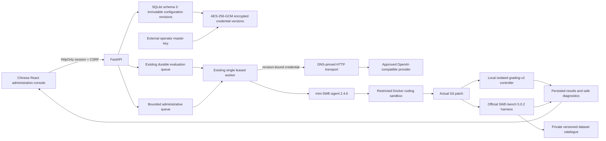

# Phase 2.7 — Dynamic administrative management

Phase 2.7 extends the accepted Phase 2.6 main checkpoint `618ff61795c2c672e5976375b17a376d1837630b`. It does not add sub2api, gpt-auto, routing, billing or distributed scheduling features.

## Configuration and credentials

Providers and models have stable independent IDs and append-only configuration revisions. New submissions resolve enabled current revisions dynamically; no API or worker restart is needed. Every run stores a non-secret model/provider/credential revision binding, endpoint hash and configuration fingerprint. Workers reload those immutable revisions rather than current mutable settings. File profiles remain a read-only compatibility source; the management API rejects conflicting IDs.

Credential values are AES-GCM ciphertext in `provider_credentials`, with random 96-bit nonces and AAD binding the database crypto namespace, provider ID and credential version. The 32-byte master key is external (`SWE_CONFIG_MASTER_KEY`). Responses, configuration histories, audit events and run snapshots never contain stored plaintext or ciphertext. A new credential creates a new version; already admitted tasks retain their old version. Explicit revocation blocks that version, including queued tasks. Disabling a provider/model blocks new admission while existing admitted revisions remain bound. Master-key replacement without re-encryption fails closed.

Dynamic-provider transport validates URL schemes, removes proxy inheritance, refuses redirects, checks every DNS answer, and connects to the validated literal address. TLS verification/SNI uses the original hostname. Private gateways and HTTP need exact server-owned origin approval in `SWE_APPROVED_PROVIDER_ORIGINS`. Metadata/link-local, multicast, unspecified and IPv6 transition addresses remain forbidden. DNS, connection, total request time and response sizes are bounded. Provider connection testing calls only `GET /models` and never sends an inference request.

## Datasets, subsets and administrative execution

The accepted Phase 2.6 private catalogue and pinned official adapter remain authoritative. Metadata import targets only the approved official dataset at an explicit 40-character commit. It never builds images. Archived revisions reject new evaluation admission without deleting historical task identities.

Custom subsets use immutable task IDs containing dataset revision, revisioned membership and a membership fingerprint. A batch may bind a specific saved subset version; admission verifies exact membership and environment readiness. Comparison cohorts preserve this selected-subset identity. Editing or duplicating a subset does not change previous coverage.

Administrative jobs use a separate durable table under the existing single worker lease. Validation requires explicit instance IDs (maximum five), one evaluation at a time, bounded per-test and whole-job timeouts, optional explicit image preparation, progress and cancellation. FastAPI never runs repository setup code. Worker supervision kills the child process group and cleans containers on cancellation/timeout. Interrupted jobs become failed and are not automatically repeated. Validation evidence remains private; ordinary responses contain classifications, counts and hashes only. READY still requires actual gold-resolved and original-code-unresolved evidence.

## Persistence and grading boundaries

`003_management.sql` is an explicit transactional migration from schema 2 to 3. Normal startup supports both schemas without automatically applying it. Run `swe-eval migrate-admin` only against an explicitly authorized database after a WAL-consistent backup. Existing run, log, verdict and provenance columns are unchanged.

Local `swe-eval-grading-v2` and official `swebench-official-v5` remain distinct. Official harness output continues to have `trusted_evidence=false` for local-v2 trust semantics. Gold validation, local deterministic stubs, legacy marker results and genuine live model inference remain separate. Currency totals are withheld across mixed currencies; unknown usage/pricing remains unknown.

## Supported database storage boundary

The independent `compose.management.yaml` uses a Linux Docker named volume for SQLite and its WAL/shared-memory files. Host directory binds remain useful for read-only configuration and non-database evidence, but macOS bind-mounted SQLite storage is excluded from the accepted deployment scope following observed native bus errors during commit. The crash location is evidence; the precise Docker Desktop/filesystem root cause is not asserted. No WAL, durability, lease or terminal-state checks were weakened to mask that observation.
