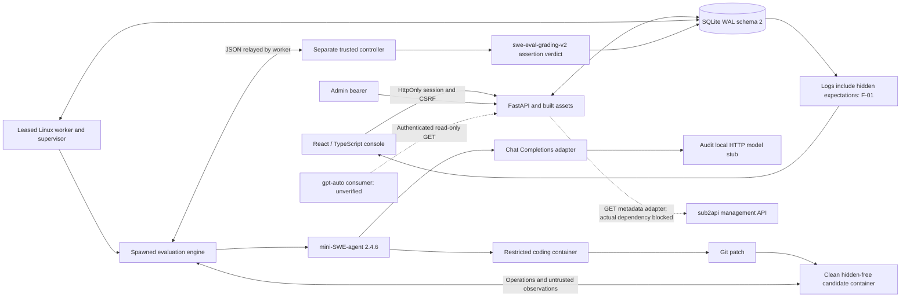

# Phase 2 Independent Acceptance Audit

Date: 2026-10-21. Evidence timestamps are UTC. This report supersedes the previous
report at this path. Its original bytes are preserved in the evidence root as
`previous-PHASE2_ACCEPTANCE_REPORT.md`. Phase 1/1.5 reports and forensic artifacts
were not overwritten.

## A. Executive Summary

**Final decision: REJECTED. Not ready for deployment.**

The standalone application completes a real browser administrator workflow,
including bounded experiments, actual mini-agent/Docker execution, trusted
grading, comparison and export. Eight unresolved defects prevent acceptance.
The most serious are hidden expected-answer disclosure, completed batches being
relabelled cancelled, and a legacy false positive reaching the dashboard's latest
repair-success indicator. External integration readiness is also unverified.

| Mandatory status | Count |
| --- | ---: |
| PASS | 9 |
| FAIL | 9 |
| BLOCKED | 2 |
| NOT TESTED | 0 |
| Total | 20 |

These counts refer only to P2-01–P2-20. Explicit unexecuted subchecks are listed
below. Findings: **P0: 0; P1: 3; P2: 5**. No unauthenticated credential disclosure
or host escape was demonstrated. No fixes were implemented during this audit.

Tested baseline: HEAD **`ccf38665e142a93e62fb761908bd7bb248d7cb4c` plus the
pre-existing uncommitted working tree frozen at 2026-10-21T10:12:04Z**. HEAD alone
does not identify this implementation. `baseline.json` records Git status and
SHA-256 hashes for 91 files; `project/` retains the selected source snapshot.
The existing `PHASE2_FINAL_FIX.patch` remains unapplied. The final built-image
suite ran **97 tests: 96 passed, one failed, zero skips**.

Environment: macOS ARM64 host; Docker Desktop 4.96.0 / Engine 29.9.1; **Linux
ARM64 containers**; Compose 5.6.0; Python 3.11.12; mini-SWE-agent 2.4.6. Project
`swe-p2-independent-101204` used separate network, volumes, images and loopback
ports 18127–18129. Recovery used an explicitly shortened **10-second audit lease**;
the default remains 90 seconds. All new inference was a local deterministic HTTP
stub. No paid inference, production service restart, routing/billing change,
sub2api management request, or production migration occurred.

Evidence root: `data/phase2-independent-audit-20261021T101204Z/`.
Unless stated otherwise, evidence paths below are relative to that root.

## B. Architecture Verification

All requested baseline documents existed and were read:
`PHASE1_ACCEPTANCE_REPORT.md`, `PHASE1_REMEDIATION_REPORT.md`,
`PHASE1_REACCEPTANCE_REPORT.md`, `PHASE2_ARCHITECTURE.md`,
`PHASE2_IMPLEMENTATION_REPORT.md`, the previous `PHASE2_ACCEPTANCE_REPORT.md`,
and `PHASE2_DEPLOYMENT_GUIDE.md`. The prior Phase 2 report disclosed an unapplied
freshness fix and an unintended auto-reload/migration of an existing development
service. Neither was assumed resolved. No requested baseline report was missing.



Implemented: all eight console sections, independent password sessions, bounded
Cartesian batch expansion, explicit attempt identities, idempotency, immutable
run snapshots, cancellation/recovery, grouped analytics, CSV/JSON and shadow
exports, additive migration and worker/queue events.

`runs` remains the durable queue. Schema 2 adds `evaluation_batches`,
`batch_attempts`, `evaluation_snapshots`, `admin_sessions`, `integration_metadata`
and `operational_events`. Progress is derived from persisted attempts. There is
no external broker, distributed scheduler or automatic retry. Explicit retries
are separate child runs outside the original batch reservation.

The Phase 1.5 process trust boundary remains intact. Coding and evaluation
candidates use a hidden-free image; only a separate controller has hidden
assertions. Runtime inspection verified all three roles: distinct host PIDs,
UID 10001, private IPC/PID namespaces, network `none`, read-only root, no host
bind/named-volume mounts or Docker socket, dropped capabilities,
no-new-privileges, 512 MiB memory and 64 PIDs. The controller independently counts
ten assertions across nine cases. A legacy stdout marker has no authority.
F-01 is a separate disclosure through the new operator interface.

Limits: one real fixture (`intervals-001`); Chat Completions only; SQLite/single
worker; response-boundary token budgets; no monetary cap; upstream pinning cannot
be inferred from a public gateway model name. There is no demonstrated installed
sub2api administration entry/shared session. CSP deliberately prevents iframe
embedding. The trusted worker has Docker-daemon authority; this audit is not a
proof against kernel escape.

## C. Acceptance Matrix

| ID | Mandatory criterion | Status | Evidence / test method | Limitations |
| --- | --- | --- | --- | --- |
| P2-01 | Frontend builds and runs | PASS | Fresh offline TypeScript/Vite build; five component tests; actual Chromium on built API. `output/frontend-fresh-build.log`, `frontend-unit.log`. | Image builds used normal cache; no bitwise reproducibility claim. |
| P2-02 | Dashboard works against real backend | FAIL | Database counts matched; empty/populated pages rendered. Legacy-only data supplied a false latest-success indicator, F-03. | Trusted rate numerators excluded legacy; timestamp did not. |
| P2-03 | Authentication/authorization | PASS | Actual anonymous reads/mutations 401; cookie CSRF/origin failures 403; real restart, logout and expiry checks. `session-checks.json`. | Standalone admin auth; sub2api role/session exchange BLOCKED. |
| P2-04 | Run detail, logs and patch | FAIL | Stored patch matched exactly and rendered. Hidden expected answers reached browser, F-01; known cost absent in detail, F-07. | History cost column works; no real credential leak observed. |
| P2-05 | Batch creation and execution | PASS | Real HTTP 2 profiles × 2 task identities × 2 attempts = 8; actual worker/engine/controller execution. `matrix-final.json`, `matrix-runs.json`. | Second task is an audit clone, not new benchmark coverage; terminal mutation is P2-07. |
| P2-06 | Batch restart durability | PASS | Exact queued-batch equality after API restart; completed artifact equality; crash recovery without duplicate execution. | Persisted status can still be relabelled incorrectly, P2-07. |
| P2-07 | Limits and cancellation | FAIL | Queue/active cancellation, 12-run cap, 16-job capacity, requests/steps/time passed. Completed batches become cancelled on explicit cancel or natural deadline, F-02. | Spending limits correctly rejected, not represented as enforced. |
| P2-08 | Correct analytics | FAIL | Grouped reference calculations passed; overview Pass@1 collapses configurations: n=4 versus 10, .75 versus .8, F-05. | Grouped comparison APIs preserve identities. |
| P2-09 | Legacy isolation | FAIL | Two legacy forms excluded from scores/exports, but legacy-only resolved=true became latest dashboard repair success, F-03. | False success timestamp, not demonstrated inflation of rate numerators. |
| P2-10 | Costs/usage/missing data | PASS | Independent known subtotals/null totals; real stub reasoning tokens not double-counted; monetary cap rejected. | Detail presentation fails P2-04; no live billing reconciliation. |
| P2-11 | Model/upstream identity | PASS | Same model alias separated by profile/upstream; reasoning, endpoint and dataset versions isolated; warnings for unverified routing. | Upstream verification is operator attestation; discovery cannot prove pinning. |
| P2-12 | Sub2api administration | BLOCKED | Sibling source inspected; no running authorized compatible administration/session instance. | Manual-link instructions are not installed integration proof; role/login/logout workflow unverified. |
| P2-13 | Safe read-only sub2api sync | BLOCKED | GET-only source contract and 13 local HTTP contract cases passed. | No actual management instance/key exercised; actual sync/persistence remain blocked. |
| P2-14 | Correct read-only gpt-auto export | FAIL | Actual auth/eligibility/read-only export exercised; pending attempts refresh authoritative timestamp, F-04. | Actual consumer E2E BLOCKED; no matching consumer found in selected sources. |
| P2-15 | Phase 1.5 regressions | PASS | Exact original forgery, forged v2 output, isolation, recovery normalization, stale writes, terminal run immutability, patches, auth/redaction, pagination and dependency gate passed on installed image. | Whole 97-test suite still fails the added freshness test; no kernel-security claim. |
| P2-16 | Security controls | FAIL | Backend auth/CSRF/isolation passed; hidden-answer disclosure and CSV control-prefix gap failed, F-01/F-06. | Formula execution and production exploitation not attempted. |
| P2-17 | Migration/persistence | PASS | Actual schema-1 copy with 24 runs preserved; idempotency, rollback/re-upgrade, injected migration failure/recovery; integrity/FK clean. | Production restore/migration not performed; startup automatically migrates configured DB. |
| P2-18 | Isolated operations/deployment | FAIL | Builds, startup, execution/recovery and provenance passed; required dedicated health observations are missing, F-08. `operations-coverage.json`, health screenshot. | Linux ARM64 and short audit lease; last heartbeat/completion and recent infrastructure errors are not exposed by system health. |
| P2-19 | Full operator workflow | PASS | Browser created two-profile bounded experiment, observed execution, inspected artifacts, compared, exported and queried shadow; separate actual restart checks. `operator.json`, `operator.log`. | Standalone workflow completion; other failed gates still prevent acceptance. |
| P2-20 | Documentation accuracy | FAIL | Prior no-hidden-expectations browser gate contradicted by actual interface; legacy-success and batch-finality claims need corrected scope. | Existing reports honestly disclose freshness defect/external blocks; those disclosures are preserved. |

## D. Runtime Evidence

### Builds and automated verification

| Evidence set | Measured result | File |
| --- | --- | --- |
| Final installed-image backend suite | **97 tests; 96 passed; one failed; zero skips; 34.962 s** | `output/full-built-suite.log` |
| Failed test | `FreshnessIntegrityTests.test_pending_attempt_cannot_refresh_authoritative_result_timestamp` | Original failed assertion retained; timestamp advanced by 1,000 seconds in fixture. |
| Fresh frontend build/typecheck | PASS; network disabled | `output/frontend-fresh-build.log` |
| Component tests | 5 passed | `output/frontend-unit.log` |
| Main HTTP/worker/limit checks | 55 checks: 52 PASS, 3 FAIL | `output/http-checks.json` |
| Independent statistics | 45 checks: 42 PASS, 3 FAIL | `output/reference-checks.json` |
| Legacy/CSV edge checks | 1 PASS, 2 FAIL | `output/edge-checks.json` |
| Cookie/session checks | 7 PASS | `output/session-checks.json` |
| Local adapter contract | 13 PASS; local HTTP only | `output/integration-contract.json` |
| Three-container policy | Three roles PASS; distinct PIDs; no remaining probe containers | `output/isolation.json` |
| No-inference CLI | Good true / unchanged false; both `matched=true` | `output/cli-fixture.log` |
| API dependency graph | pip check clean | `output/pip-check-api.log` |
| Worker compatibility | Audited lean gate PASS; raw pip check `FAILED_EXPECTED`, exact nine omitted mini extras | `output/dependency-gate.log` |

These sets overlap requirements and must not be added into a purported unique
acceptance count. Browser procedures completed against empty, populated,
legacy-only, known-cost reference and operator states. A completed capture
procedure is not an absence-of-defects assertion: `detail-cost.json`, for example,
explicitly records FAIL despite successful browser automation.

Two first browser attempts failed due to audit-helper selection errors: a
nonexistent form-close label, then selecting a cancelled run with no patch.
Original logs remain `browser-empty.log` and `browser-populated.log`. The helper
was corrected to use the actual toggle and a completed profile-filtered run.
No existing test, implementation or expected product behavior was weakened.
Docker archive copying could not see a tmpfs backup; the unchanged backup was
successfully retrieved through exec. Original/retry logs remain available.

### Eight-attempt real execution

Matrix batch: **`de18714215e34cf3b7c55bd603936dc9`**.

| Task | Profile | Attempt | Run ID | Resolved |
| --- | --- | ---: | --- | --- |
| intervals-001 | stub-good | 1 | 53fced0de85449f8808c1818b70d5ed9 | true |
| intervals-001 | stub-good | 2 | 6fa02a80ba8a4535ad1266587544cf1d | true |
| intervals-001 | stub-bad | 1 | 0e22c0ab11f44d0ea21af9637d135976 | false |
| intervals-001 | stub-bad | 2 | 935df9f52b59430d9c32092b13abff01 | false |
| intervals-audit-002 | stub-good | 1 | 547d0b52be7c4bc19a2b2d606636692f | true |
| intervals-audit-002 | stub-good | 2 | d7b941f000924e12949bf56156a83789 | true |
| intervals-audit-002 | stub-bad | 1 | bfafb2e7cddd461698eb75e15e5a8d62 | false |
| intervals-audit-002 | stub-bad | 2 | a1127d129db44dff90d85311098da52c | false |

All eight genuinely completed ten controller assertions. Good repairs passed
ten; unchanged code passed four and failed the remaining assertions. IDs,
task/profile identities, attempt numbers, batch IDs, effective reasoning `low`,
upstream identities and v2 provenance were verified. Good-run usage was 30 input,
15 output, 6 reasoning and **45 total** tokens; reasoning was not added again.
All costs remained null because pricing was unknown.

`intervals-audit-002`, version `audit-clone-1`, is an explicitly isolated clone
for orchestration coverage. Source and assertions were preserved; it does not
establish a second independent benchmark capability. The accepted original was
not modified. All profiles were `local_stub`, not live model scores.

Browser operator batch **`12650fe387714dbd8671a057743b3930`** used the original
task and two profiles, producing one resolved and one unresolved result through
the actual worker. The browser procedure completed in 8.2 seconds. CSV/JSON
showed two distinct groups and one genuine common task. Shadow eligible items
were empty because the attempts were stubs.

Recovery batch **`a7f351fd8f5a459ba44b74b2ad2042f6`**: SIGKILL of only the audit
worker during an active sleeping-profile run left one observed orphan coding
container. After the 10-second lease/restart,
`a69e0261209a4f6299c8716fd0038859` became
`failed / worker_interrupted / resolved=null`, retaining one model request.
The orphan was removed and queued run `909e2252c9f7401191e9b14219b2c31d` completed
successfully. Measured sequence: 17.124 seconds. The interrupted run was not
reexecuted; an explicit retry had a new ID, correct parent and no original-batch
membership. No claim is made about the exact sandbox command timing at SIGKILL.

Other actual checks: invalid task/profile; empty/oversized batches; duplicate new
submission versus idempotent replay/conflict; worker unavailable; partial 503
failure; timeout; queued/active cancellation; deadline; API restart during worker
interruption; maximum queue; single-step/single-request limits; and interrupted
database insertion. An aborting audit-only trigger caused HTTP 500 with no new
records (49 before and after); removing it and replaying created exactly one run.
That injected failure is not a spontaneous application fault.

Final main audit database: **50 attempts: 15 completed, 2 failed, 1 timeout,
32 cancelled**. Many cancellations are intentional capacity/duplicate fixtures.
Failed attempts and progress samples were preserved. Backups:
`runtime-final.sqlite3`, `reference-final.sqlite3`, `legacy-final.sqlite3`.

### Browser observations and screenshots

All eight navigation sections were visited against actual empty and populated
APIs: Overview, Runs, Batches, Comparison, Tasks, Profiles, Health and Settings.
Actual login failure, authenticated refresh, logout/revocation, offline network
failure, desktop/mobile layout and theme switching were exercised. No uncaught
page errors occurred. Recorded console/network errors were expected 401s and the
deliberate `ERR_INTERNET_DISCONNECTED`; no unexplained failure was identified in
the completed procedures. All eight mobile document-width checks at 390×844
passed. This is not an accessibility certification.

| Capture | File under `output/` |
| --- | --- |
| Dashboard | `populated-dashboard.png` |
| Run history | `populated-history.png` |
| Run detail / patch | `run-details.png`, `run-patch.png` |
| Batch configuration | `operator-batch-configuration.png` |
| Progress / completion | `operator-batch-progress.png`, `operator-batch-final.png` |
| Comparison | `operator-comparison.png` |
| System health | `populated-health.png` |
| Authentication failure | `populated-unauthorized.png` |
| Legacy false-success | `legacy-only-dashboard.png` |
| Hidden answer exposure | `run-hidden-expectations.png` |
| Known-cost omission | `run-known-cost-omitted.png` |
| Mobile / dark / network error | `populated-mobile.png`, `dashboard-dark.png`, `populated-network-error.png` |

Main counts matched SQLite. No hardcoded benchmark performance was found being
presented as persisted results. The displayed patch matched stored bytes. Model,
upstream, task, steps/requests, assertions, usage, errors and execution metadata
rendered. Known cost and hidden-content handling failed as documented.

Refresh preserves authentication but returns to Overview: navigation is component
state rather than URL routing. Overview/session loading, empty views and a real
offline error were exercised. Exhaustive delayed-loading/error permutations for
every section were **NOT TESTED**; polling views generally have no loading flag
and can initially show an empty state. No HTTP responses were mocked for browser
acceptance.

### Commands and HTTP evidence

Material executed forms, from the frozen project/evidence directory:

```bash
docker build -t swe-p2-independent-sandbox:20261021t101204 -f docker/sandbox.Dockerfile .
docker build --build-arg SANDBOX_IMAGE=swe-p2-independent-sandbox:20261021t101204 \
  -t swe-p2-independent-grader:20261021t101204 -f docker/grader.Dockerfile .
docker build --target api -t swe-p2-independent-api:20261021t101204 -f docker/service.Dockerfile .
docker build --target worker -t swe-p2-independent-worker:20261021t101204 -f docker/service.Dockerfile .
docker build --target development -t swe-p2-independent-development:20261021t101204 -f docker/service.Dockerfile .
docker build -t swe-p2-independent-browser:20261021t101204 -f docker/browser-tests.Dockerfile .
docker compose --env-file /dev/null -f compose.json up -d --no-build api stub
python3 runtime.py initial
docker compose --env-file /dev/null -f compose.json up -d --no-build worker
python3 runtime.py matrix
python3 runtime.py recovery
python3 limits_probe.py
python3 reference_validate.py
python3 session_probe.py
python3 finalize.py
```

Helpers retain full test payloads, Docker invocation arguments and assertions.
`output/http-transcript.jsonl` records real response bodies/statuses. Observed:
anonymous access **401**; CSRF **403**; submission **202**; idempotency/capacity
**409**; invalid selection/overflow/spending cap **422**; unconfigured integration
**503**; comparison/exports **200**. Reproduction requires **fresh** evidence
paths/project names/databases: seed helpers are one-pass audit fixtures, not
production maintenance tools.

## E. Statistical Validation

The separate reference API had no worker. Its initial 21 records are **synthetic
statistical fixtures, not executed evaluations**. Some deliberately carried
`live`/upstream-verified metadata solely to test export eligibility in that
isolated database. They never entered the main runtime DB or any real ranking.
The volume was removed. Two later CSV probes added audit-tagged records after
the saved reference validation responses.

Coverage included success, repair failure, initial API failure, explicit retry,
second numbered attempt, interruption, timeout, cancellation, pending work,
different upstreams/profiles/reasoning/endpoints/dataset versions, unequal task
coverage, legacy without provenance, explicit legacy protocol, audit origin and
missing costs/usage. `reference_validate.py` calculated expectations without
importing application analytics; actual values came from running HTTP APIs.

| Core group metric | Independent expected | Actual |
| --- | ---: | ---: |
| Attempts / valid / resolved | 9 / 4 / 3 | Same |
| Valid repair success | 3/4 = .75 | .75 |
| End-to-end success | 3/9 = .3333333333 | Same |
| Pass@1 | 0/2 = 0 | 0 |
| Infrastructure errors/rate | 3/9 | Same |
| API errors / requests / rate | 1/14 = .0714285714 | Same |
| Terminal duration samples | 10,20,30,40,50,60,70,80 | Same |
| Average / P50 / P95 seconds | 45 / 45 / 76.5 | Same |
| Known costs / unknown attempts | 18 / 4 | Same |
| Total / average / cost per resolved | null / null / null | Same |
| Known input/output/total subtotals | 500 / 180 / 680 | Same |
| Complete token totals | null | null |
| Matched versioned tasks for core A/B | 1 | 1 |
| Legacy exclusions | 2 | 2 |

Valid repair rate counts completed authoritative v2 assertions or patch rejection.
Infrastructure failures stay in the all-attempt denominator. Pass@1 selects the
first independent task/configuration attempt; retry children and attempt >1
cannot replace an initial failure. Pending/cancelled attempts remain visible.
Percentiles use linear interpolation at `(n-1)*p`; the eight-sample P95 is
`70 + .65*(80-70) = 76.5`. Implemented latency includes terminal cancellations,
including zero duration for a never-started cancellation: it is not latency of
executed repairs alone.

Grouped comparison correctly separated identities/versions, displayed small
sample warnings and used actual task intersections. No official SWE-bench score
or general ranking was generated. Incomplete work did not become successful
repairs. Stub/audit origins were labeled and excluded from shadow eligible
outcomes. Unknown usage/pricing remained null; no reasoning-token double count
was observed.

Three statistical failures: shadow timestamp **300 instead of 110** after pending
work; overview first-attempt coverage **4 instead of 10** task/configuration
pairs; overview Pass@1 **.75 instead of .8**. Separate legacy-only testing showed
a non-null recent-success timestamp with trusted resolved count correctly zero.

## F. Security Findings

### F-01 — P1 / High: hidden expectations exposed to browser/log consumers

Affected: `src/swe_eval/engine.py:115`,
`src/swe_eval/benchmarks/data/intervals/hidden/grade.py:48`,
`src/swe_eval/api.py:123`, `frontend/src/main.tsx:36`.

Root cause: the controller includes per-case `expected`/observed values; the
engine persists the complete verdict as `trusted_assertions`, and the log API/UI
returns it unchanged.

Reproduce: run the good stub on the original fixture; GET
`/api/v1/runs/53fced0de85449f8808c1818b70d5ed9/logs`; inspect
`trusted_assertions.details[*].expected`; open Execution Logs in the real console.
`browser-populated.json` records `hiddenExpectationsVisible=true`; screenshot
and `actual-run-logs.json` preserve evidence.

Impact: hidden expectations reach authenticated console/log consumers, contrary
to the requested boundary. This is not unauthenticated access or candidate file
access; forged verdicts still failed. Minimum remediation: store/serve sanitized
assertion counts and safe failure summaries, keeping expectations out of ordinary
browser logs; add negative browser/API regressions.

### F-06 — P2 / Medium: incomplete CSV formula neutralization

Affected: `src/swe_eval/api.py:240`. Sanitization only handles an immediately
leading `=`, `+`, `-`, or `@`. Reproduce with controlled model IDs `=1+1` and
`\t=1+1`, then export CSV. The first receives an apostrophe; the second remains
unchanged. See `edge-checks.json` and `csv-security.csv`.

Impact: the export does not consistently neutralize strings for spreadsheet
consumers that interpret control-prefixed formulas. **Only exported bytes were
verified; spreadsheet/command execution was NOT TESTED.** All payloads were
harmless arithmetic strings in an isolated reference database. Minimum fix:
centralize text protection for whitespace/control-prefixed dangerous values and
add tab/newline regression cases.

Executed controls that passed: real unauthenticated/limited-token access checks,
cookie CSRF/origin/logout/expiry, batch parameter injection, artifact traversal,
pagination overflow, credential-redaction regressions, unsafe metadata URL syntax,
GET-only metadata whitelist, candidate/controller isolation and cleanup. Actual
served JS/CSS contained no audit admin/shadow/password/management canaries
(`served-assets-scan.json`). No real model key was supplied to the deployment.

Migration authorization was inspected: `repository()` calls initialization and
upgrade at startup without a separate approval switch. That documented behavior
was exercised only on new/copied audit DBs. Deliberate deployment selection is
still required; this audit did not repeat the historical source-mount incident.

## G. Integration Status

| Boundary | Actually exercised | Classification |
| --- | --- | --- |
| Standalone SWE | Built API/React, actual SQLite queue, Linux worker, mini, local HTTP stub, coding/candidate/controller containers, browser/export | Real stub-driven infrastructure E2E; unresolved findings prevent acceptance. |
| Sub2api administration | Read-only source and standalone console controls | Actual administration/session integration BLOCKED. |
| Sub2api synchronization | Installed adapter against local HTTP contract server: malformed/auth/unavailable/duplicate/removed-model/URL cases, GET-only and secret whitelist | 13 contract checks PASS; actual sub2api synchronization BLOCKED. |
| gpt-auto export | Real protected HTTP API, synthetic eligibility/reference data | Read-only surface verified; freshness FAIL; consumer E2E BLOCKED. |

Sibling sub2api source initially reported revision
`7eb3843d71bb590ab69db56dc6c6d6175689373d`; a later read reported
`5de4efe9f68d3c0aca65ecda87627fb1a1ac026b`. It apparently changed independently
and was not a frozen audit target. No writes were made there. Selected later
file hashes are in `integration-source-evidence.json`; no runtime acceptance of
either revision is claimed.

Source-confirmed route: `GET /api/v1/admin/groups/:id/effective-models`, behind
sub2api admin middleware, returning its models contract. Public model names do
not attest a channel/account. The adapter maps server-owned profiles/groups,
always leaves imported upstream attribution unverified, and does not import
account secrets or modify profiles, prices or routing. A manual Markdown-link
instruction is not proof that an entry is installed or authorized in a real UI.

Sub2api's existing iframe helper adds an auth token to URLs. SWE does not use it:
actual responses specify `frame-ancestors 'none'` and `X-Frame-Options: DENY`.
No token federation/iframe bypass was installed. Compatible cross-service cookie,
role, expiry and logout behavior remain BLOCKED.

No `gpt-auto-swe-v1`/SWE-export consumer was found in the selected sibling
backend/frontend source search. No Phase 2 path was found writing production
routing tables, weights, billing multipliers, Jev rules, user routing or upstream
assignments. No production action occurred. This is source/capability-path
evidence, not a comparison of an external production database against unrelated
concurrent activity.

## H. Defect List

| ID | Priority | File/line and root cause | Minimal reproduction and impact |
| --- | --- | --- | --- |
| F-01 | P1 | `engine.py:115`, `grade.py:48`, `api.py:123`, UI `main.tsx:36`: full controller verdict logged and rendered | Execute trusted fixture, fetch/view `details[*].expected`; hidden corpus disclosed. See security reproduction above. |
| F-02 | P1 | `storage.py:348`, `:358`, `:376`: deadline UPDATE includes completed batches; cancel always sets flag; derived terminal state follows flag | Complete a batch with max_duration=8, then wait past deadline. State completed→cancelled with completed=1, cancelled=0. Explicit cancel similarly relabels completed batch. Durable terminal classification is corrupted. |
| F-03 | P1 | `storage.py:415`, UI `main.tsx:25`: latest-success query checks only completed/resolved=true, not v2/provenance | Legacy-only completed/resolved=true fixture: trusted resolved=0, but latest-success timestamp populated and rendered as recent repair. A legacy false positive reaches a trusted dashboard indicator. |
| F-04 | P2 | `analytics.py:114`, `:163`: timestamp uses all attempted/queued records | Completed finish=110, pending created=300; shadow evaluated_at=300. Stale evidence appears newer; existing 97th regression also fails. |
| F-05 | P2 | `api.py:193`, `analytics.py:57`: overview summarizes all configurations but first-attempt key is only task fingerprint | Reference overview gives n=4/.75 versus independent task/config n=10/.8. Grouped comparisons remain correct. |
| F-06 | P2 | `api.py:240`: immediate-prefix-only CSV sanitizer | Export tab-prefixed harmless formula string unchanged. Downstream formula handling is insufficiently protected; execution not attempted. |
| F-07 | P2 | UI `main.tsx:35`, `:38`: detail fields omit metrics.cost/currency | Persisted reference cost=2; actual drawer has no cost/currency field. History/API still expose the value. `detail-cost.json`, screenshot. |
| F-08 | P2 | `storage.py:409` operations response and frontend `main.tsx:68` Health view omit required observations | Actual health data exposes lease expiry and last success, but no last-heartbeat timestamp, last completed run, or recent infrastructure-error list. Manual run queries remain possible; health observability is incomplete. |

F-02's automatic test observed completed before waiting, then cancelled with
`stop_reason=batch_deadline_exceeded`, `terminal=total=1` and **one completed,
zero cancelled attempts**. It does not require an operator to issue cancellation.
Records were not lost or duplicated; terminal batch semantics are wrong.


The supplied freshness patch is preserved as prior proposed work, not applied or
newly accepted. Every finding has executable audit fixtures and actual outputs
or screenshots. No baseline defect was silently repaired.

## I. Remediation Recommendations

1. Strip hidden expectations/observations from ordinary API/UI logs; retain safe
   assertion counts and failure classifications.
2. Reconcile deadlines only for unresolved work; completed-batch cancellation
   must reject or no-op without changing history. Test natural deadline passage
   as well as explicit cancellation.
3. Reuse the authoritative v2/provenance predicate for every trusted success
   indicator, including latest successful repair.
4. Derive quality freshness only from eligible completed evaluations. Review the
   pending patch and define comparison attempted-versus-evaluated timestamps.
5. Group overview Pass@1 by task and full configuration, or omit an aggregate
   whose cross-configuration meaning cannot be defended.
6. Harden CSV text handling; display known/unknown cost and currency in details.
7. Add explicit heartbeat/completion and recent infrastructure-error observations to system health. Lease expiry and last successful repair have different meanings.
8. Correct documentation and rerun failed probes plus the final built-image
   suite. Exercise an authorized compatible sub2api staging instance and actual
   gpt-auto consumer before accepting those integrations.

Before applying changes in the shared checkout, deliberately isolate/coordinate
existing source-mounted services. This audit needs no production rollback,
restart or migration.

## J. Final Deployment Recommendation

**Not ready for deployment.** Useful standalone functionality is demonstrated,
but hidden-data, legacy-success and completed-batch defects prevent acceptance.
Isolated staging can reproduce/remediate findings; this audit does not approve
trusted production scoring or routing consumption.

Schema migration was rehearsed on an actual copy of accepted Phase 1.5 audit
data: **24 runs**. Upgrade 1→2 preserved complete historical rows/logs, repeated
initialization was idempotent, no snapshots were backfilled, and historical
comparison remained empty. Rollback/re-upgrade retained rows. An authorizer-denied
migration rolled back all partial DDL, retained version 1, and subsequently
upgraded successfully. Integrity was `ok`, foreign-key violations empty. Evidence:
`migration.log`. Actual API/session/run/log/patch/batch restart persistence was
also verified. Production backup/restore was not executed.

All audit containers, both named audit volumes and their network were removed
after backups, logs and artifact/source hashes were saved. Image tags were
retained. Original API and worker kept their IDs, image IDs, start times and
restart counts: **API 0, worker 13**. Worker start time at both observations:
`2026-10-21T07:50:08.093509875Z`. Earlier reports recorded other restart snapshots;
this audit establishes no cause for historical restarts and invents none.
Orphan cleanup was observed after acquisition/continuation; database recovery
and external Docker cleanup are not claimed to be one atomic transaction.

Installed API and production worker matched all **31 frozen package source/data
files**, and complete package manifests including assets matched each other.
See `installed-artifact-provenance.json`, `image-identities.json` and final source
integrity/hash manifests. Pre-report verification found **zero baseline file
changes**. The only replacement of a pre-existing project file is this requested
report, whose predecessor is preserved.

**NOT TESTED / explicit limits:** live paid inference/reasoning variants;
actual sub2api administration/management/session behavior; actual gpt-auto
ingestion; production TLS/iframe federation; hosted CI execution; other CPU
architectures/native macOS worker; CVE/advisory scans; destructive kernel escapes;
saturation/OOM/fork stress; shared-daemon outage; hard-power-loss database
behavior; default-90-second wall-clock crash rehearsal; git-bundle task execution;
exhaustive per-page loading/error permutations; spreadsheet formula execution.
External integration runtime checks are BLOCKED by unavailable authorized
dependencies. Destructive/production checks were deliberately not run.
