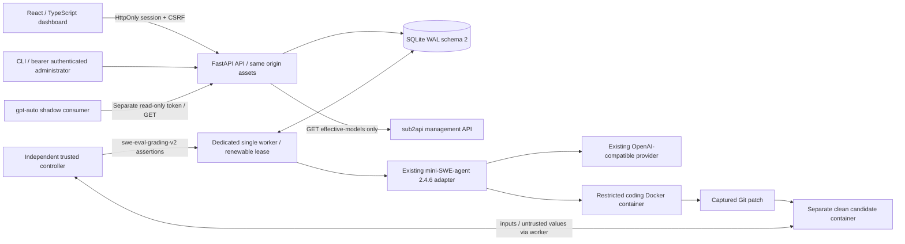

# SWE Evaluation Center architecture

Phase 2 extends the accepted Phase 1.5 working tree; it does not replace the
execution engine. Version 0.2.0. Supported worker runtime: Linux Docker.

## Phase 2.5 corrected boundaries

Phase 2.5 retains this topology and schema 2. Controller verdicts and raw hidden
operation output stay in trusted process memory. New ordinary logs contain only
allowlisted assertion counts/classifications and operation exit status; reads
filter historical unsafe payloads without rewriting forensic records. Run-detail
execution metadata is allowlisted again at the API boundary.

Trusted overview/success indicators require complete v2 provenance, agent mode,
live origin, completed authoritative assertion accounting (or patch rejection).
Non-live comparison experiments remain explicitly diagnostic, with separate
origin groups and `trusted_evidence=false`; they cannot enter trusted overview
success or shadow quality. Shared eligibility predicates live in `analytics.py`.
Pass@1 identifies the earliest independent numbered-1/unnumbered attempt per full
versioned task/configuration, including profile, upstream, endpoint, effective
settings, harness and protocol. Explicit retry children never add coverage.

Batch terminal state derives from immutable attempt outcomes. All-completed work
stays completed, stopped work stays cancelled, other terminal infrastructure
failures produce failed batches. Deadline/cancel writes require unresolved work
inside the same SQLite write transaction. Cancelling a terminal batch is an
idempotent HTTP 202 no-op. A final completion winning a race remains completed.

Quality `evaluated_at` uses valid completed live evidence only;
`last_attempted_at`, `last_trusted_success_at`, and export `generated_at` are
separate. Heartbeat timestamps are recorded by successful worker acquisition and
renewal; health also exposes completion IDs/times, recent failed/timeout runs,
lease state and observed cleanup state. Unknown Docker/upstream information is
never promoted to healthy. No new monitoring dependency or schema upgrade.

## Baseline and topology

The accepted source is **not a committed revision**. HEAD is
`ccf38665e142a93e62fb761908bd7bb248d7cb4c` plus existing local changes.
`data/phase2-20261021/baseline.json` freezes hashes before Phase 2 edits.
Prior reports and evidence remain untouched. The baseline installed Linux image
ran 70 tests with no skips before changes. Existing API/worker containers are
older services; no assumption is made that they run the accepted corrected build.
No image-upgrade or targeted restart command was issued. **However, a late
mount inspection found source bind mounts and API auto-reload: the existing
SWE development API indirectly loaded 0.2.0 and initialized schema 2. This is a
recorded deployment-isolation failure, not an authorized migration.** No rollback
or database rewrite was attempted; see the acceptance report.

The final diagram edge between controller and candidate is **worker-mediated**;
there is no shared network or mount. Grader, candidate runner, provider and agent
implementations are preserved. Only effective launch-limit loading is added to
the engine. Worker supervision retains lease fencing, cancellation, deadlines,
recovery normalization, terminal immutability and Docker cleanup.

## Dashboard and authentication

React 19, TypeScript, Vite; exact versions in `frontend/package-lock.json`.
Simplified Chinese catalog, light/dark theme, responsive sidebar and tables.
Theme preference alone is stored in localStorage. A separate console password
is PBKDF2-SHA256 hashed (600,000 rounds). Opaque eight-hour sessions and CSRF
secrets are hashed in SQLite. HttpOnly/SameSite=Strict cookies default Secure;
mutations also require an exact configured Origin and CSRF header. Login is
same-origin and rate limited globally to ten failed attempts per minute.

The existing admin bearer remains a server-side/programmatic credential; it is
never embedded in assets or returned by login. A separate shadow bearer permits
only the read-only export. No CORS relaxation or iframe token exchange exists.
CSP prohibits framing and external scripts; React escapes logs and patches.
Only authenticated administrators can read artifacts, including diagnostic logs.
The API never mounts a Docker socket; only the isolated trusted worker does.

## Persistence and orchestration

Migration `002_center.sql` adds `evaluation_batches`, `batch_attempts`,
`evaluation_snapshots`, `admin_sessions`, `integration_metadata`, and
`operational_events`. Existing run/log rows and verdicts are not rewritten.
Migration is transactional and repeatable. Offline rollback SQL is provided for
restored copies; backup restoration is preferred because rollback discards new
Phase 2 metadata. SQLite foreign keys connect attempts and snapshots to runs.

Batch submission validates all tasks/profiles/limits before a single transaction
inserts every explicit attempt. An idempotency key binds the request hash; a
repeated identical request returns the original experiment, while conflicting
reuse returns 409. Queue capacity is checked in the insertion transaction.
Retries are separate child runs; reconciliation never resubmits paid work.

Snapshots record dataset/task identity, effective profile, reasoning, endpoint
hash, upstream verification flag, data origin, source harness hash and runtime
fingerprint. API callers cannot supply these authoritative fields. Original
profile/configuration checks still run before effective limits are loaded.
Limits can only shrink the configured timeout/steps/requests/output/total tokens.

Per-attempt complete model-call allowances are reserved at submission. Their sum
must fit the batch request allowance, independent of missing token usage. Batch
deadlines cancel queued runs and request active cancellation before another
claim; progress is derived from durable attempts, so restarts cannot lose it.
When no worker is alive, deadline enforcement resumes on acquisition before any
new work starts. Token thresholds are checked between responses, as in Phase 1;
there is no hard monetary guarantee. Spending-limit requests are rejected rather
than given an unreliable guarantee. Parent retries consume the ordinary queue
and are explicitly outside the original batch's reserved budget.

## Analytics integrity

Scored groups require new immutable snapshots and grading v2. Legacy and
unattributed historical results remain visible in run history but are excluded
from comparisons. Patch-verification runs are not model scores. An authoritative
assertion outcome requires complete assertion accounting and a controller digest;
patch rejection is a valid unresolved repair. Infrastructure failures have null
resolution and remain in end-to-end denominators.

Grouping separates profile, upstream, reasoning, effective configuration,
benchmark, dataset and harness. The common task fingerprint intersection is
reported per identical benchmark/dataset/harness cohort. Controller digest
mismatches make comparisons ineligible. Valid-evaluation resolved rate and
all-attempt success rate have separate denominators. Pass@1 uses the first
independent attempt per versioned task/configuration, including infrastructure
failure; retries and numbered attempt >1 cannot become a new first attempt.
Percentiles use linear interpolation. Unknown tokens/costs remain null, with
explicit known subtotals and unknown counts. No ranking is generated.

Shadow export additionally requires server-declared live origin and independently
verified upstream attribution; local stubs, audit data, unsupported tasks,
incomplete outcomes and legacy records cannot enter scored outcomes. Exported
reliability and first-attempt denominators retain excluded infrastructure attempts.
Tiny sample eligibility is false, and capability weights are always null.
Only the implemented local intervals benchmark is currently supported for export.
A configuration flag is operator attestation, not proof of upstream routing.

## sub2api discovery and integration boundary

Sibling checkout inspected read-only at revision
`7eb3843d71bb590ab69db56dc6c6d6175689373d`: Vue/Pinia/Vue Router frontend,
Go/Gin backend, administrator JWT or `x-api-key` middleware. Source contract:
`GET /api/v1/admin/groups/:id/effective-models` returns `{code:0,data:{models:[]}}`.
It exposes public model names, not a concrete guaranteed account/channel route.
The adapter imports only whitelisted metadata from that GET. It never lists
accounts, requests account credentials, accesses the gateway database or mutates
configuration. A server-owned mapping supplies stable source/group identities.
Unknown response schemas fail before replacing the previous successful snapshot.
Pricing/capabilities remain unknown when not exposed.

`frontend/src/utils/embedded-url.ts` adds JWT `token` to iframe URLs. That path is
not used. The source also supports Markdown custom pages; an administrator can
put a plain dashboard link on an admin-visible Markdown page without iframe
construction. No gateway files/settings were changed. Actual live management
sync and secure shared-session federation remain BLOCKED without an authorized
compatible staging environment/metadata key. Standalone login remains functional.
The reverse-proxy sample supplies a dedicated HTTPS origin, not invented SSO.

## Operational boundaries

System health distinguishes API/database readiness, lease validity, worker
readiness after cleanup, last Docker probe, and unprobed upstream availability.
Worker-start/recovery/cleanup-duration/failure events and queue timestamps persist;
failed HTTP responses are counted without body/header logging. Operational events
are retained to 10,000 rows; counters are retained observations, not lifetime
container restart telemetry. Docker availability is the last worker probe, not
continuous daemon monitoring. Native macOS worker supervision is still unverified.
