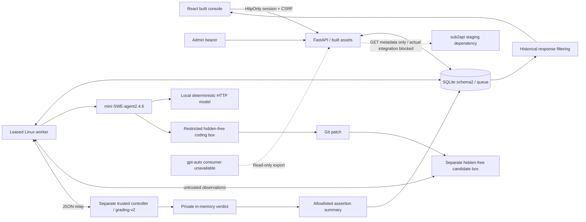

# Phase 2.5 Re-acceptance Report

Date: 2026-10-21. Runtime timestamps UTC. Evidence: `data/phase25-remediation-20261021T114531Z/`.

**Local promotion completed at the user’s explicit request on 2026-10-21.**
All 17 verified changes are now applied to the shared checkout. The local SWE API
and worker have been restarted using the verified immutable Phase 2.5 images;
source bind mounts and automatic reload are no longer used by these services.
The existing temporary console password still works at http://127.0.0.1:8000/.

Fresh promotion evidence is under `data/phase25-promotion-20261021T133012Z/`:
13/13 deployment checks and a real Chromium login/health/run-log/patch workflow
passed. The four existing run rows and all 39 historical log rows were preserved
byte-for-byte; two explicit no-inference v2 patch-verification runs were added.
Schema remains 2. The original Phase 2/2.5 audit evidence is unchanged. No paid
inference or sub2api/routing/billing change occurred. Rollback source and a SQLite
backup are retained in the private promotion evidence directory.

The default local sandbox/grader image tags were discovered to be obsolete.
They were preserved for rollback; `compose.phase25.local.yaml` selects the
verified API/worker images and a server-owned copy of the original fixture with
verified sandbox/grader image references. Source and hidden assertions are
unchanged; new run snapshots identify the effective runtime. See
`PHASE25_LOCAL_DEPLOYMENT.md` for the exact start/restart commands.

## Decision and environment

**CONDITIONALLY ACCEPTED: verified standalone corrected bundle only; external
integration excluded.** Shared-checkout promotion is complete as recorded above.
Original criteria: **18 PASS,0 FAIL,2 BLOCKED,0 NOT TESTED**. Remediation gates:
**10 PASS,0 FAIL,0 BLOCKED,0 NOT TESTED**. Unresolved demonstrated defects in the
corrected build: **P0=0,P1=0,P2=0**. Explicit unexecuted subchecks below are not
hidden PASS. Full ACCEPTED is not justified without actual external integrations.

Linux ARM64 Docker Desktop Engine29.9.1/Compose5.6.0 on macOS ARM64;
Python3.11.12,mini2.4.6. Project swe-p25-remediation-114531 has its own network,
three named volumes and loopback ports18227–18229. Test image names are
swe-p25-remediation-{api,worker,development,sandbox,grader,browser}:20261021t114531.
No existing image tag was rebuilt. Normal build caching was used; no bitwise
reproducibility claim. Recovery lease10s is an explicit test-only wrapper;
production default90s remains unchanged.

`final-source.json` identifies corrected selected files; `image-identities.json`
identifies actual built artifacts. API/worker installed package manifests match
all33 source/data files and each other, including built assets. No mismatch.
The shared checkout now contains the verified application source. Promotion-only deployment configuration and this documentation update are recorded separately.

## Verified architecture



Candidate/controller PID,IPC,network and mount separation remains intact; three
actual role probes found UID10001,read-only root,network none,no host mounts or
Docker socket,drop ALL/no-new-privileges,512MiB/64PID and distinct host PIDs.
Only the controller had hidden files. No remaining probe containers.

## Original acceptance matrix

| ID | Criterion | Status | Evidence / method and limits |
|---|---|---|---|
| P2-01 | Frontend builds and runs | **PASS** | Eight component tests, final TypeScript/Vite build, real Chromium on final API. |
| P2-02 | Dashboard against real backend | **PASS** | Counts match SQLite; live-only trusted metrics; legacy-only latest success null; actual browser. |
| P2-03 | Authentication and authorization | **PASS** | Real 401/403 checks; seven cookie/session checks, logout, expiry and API restart. |
| P2-04 | Evaluation detail, logs and patch | **PASS** | Real stored patch equality; safe logs including historical canary; known 2.0000 USD rendered; unknown explicit. |
| P2-05 | Batch execution | **PASS** | Eight-attempt matrix and final-image browser-created experiments execute through actual mini/Docker/controller. |
| P2-06 | Restart durability | **PASS** | Queued/completed API restart equality; final artifact recreation retains runs; worker crash recovery. |
| P2-07 | Limits and cancellation | **PASS** | 55 HTTP checks; natural completed deadline/cancel no-op; active/queued deadline; limits; SQLite race/finality tests. |
| P2-08 | Mathematically correct analytics | **PASS** | 47 independent reference checks; full-config diagnostic n=10/.8; trusted live-only n=9, Pass@1=7/9. |
| P2-09 | Legacy isolation | **PASS** | Legacy-only success timestamp null, resolved zero; protocol/provenance filters; exports exclude legacy. |
| P2-10 | Costs, usage and missing data | **PASS** | Unknown remains null; known subtotal18; no reasoning-token double count; detail currency; spending cap rejected. |
| P2-11 | Model and upstream identity | **PASS** | Profile/upstream, endpoint, reasoning, dataset, effective configuration and harness grouping preserved. |
| P2-12 | Actual sub2api administration | **BLOCKED** | No authorized compatible staging admin/session interface; plain-link instructions are not installed integration. |
| P2-13 | Actual sub2api synchronization | **BLOCKED** | Sibling source compatible; 13 GET-only local contract cases pass; no authorized management instance/key. |
| P2-14 | Correct read-only gpt-auto export | **PASS** | Actual protected export; authoritative timestamp110 despite pending300; legacy/non-live excluded; consumer E2E BLOCKED separately. |
| P2-15 | Phase 1.5 integrity regressions | **PASS** | Final installed suite includes exact original exploit, forged output, hidden isolation, recovery/stale writes/terminal metrics, patch/auth/redaction/overflow. |
| P2-16 | Security controls | **PASS** | Confidentiality at write/read/API boundaries; historical filtering; CSV parser/bytes; auth/CSRF; three-role sandbox and asset scan. |
| P2-17 | Migration and persistence | **PASS** | 24-record Phase1.5 copy: idempotent 1-to-2 migration, rollback/re-upgrade, injected failure rollback/recovery; no trust backfill. |
| P2-18 | Deployment and operational health | **PASS** | Final six image targets; actual stale heartbeat/recovery five checks; worker/queue/completion/error/cleanup data; API readiness separate. |
| P2-19 | Standalone operator workflow | **PASS** | Real browser login/profile selection/bounded two-profile batch/progress/result/log/patch/comparison/CSV/JSON/shadow; actual worker execution. |
| P2-20 | Documentation matches verified behavior | **PASS** | Corrected architecture/deployment/implementation documentation in verified source bundle; evidence limits and staging instructions explicit. |

P2-14 PASS applies to the export producer contract, not an unavailable actual
consumer. P2-12/P2-13 remain BLOCKED despite passing local adapter contracts.
P2-20 applies to the corrected documentation. Source promotion was explicitly authorized and performed with both old services stopped.

## Remediation gates

| Gate | Requirement | Status | Evidence |
|---|---|---|---|
| RG-01 | Hidden grading data absent from ordinary outputs | **PASS** | Historical DB canary survives privately; API/repository/browser filters; real grader logs use allowlists. |
| RG-02 | Completed batch cannot become cancelled | **PASS** | Actual natural deadline, repeated explicit no-op, SQLite completion/reconcile race and failed-terminal regression. |
| RG-03 | Legacy cannot influence trusted dashboard success | **PASS** | Legacy-only API/browser zero/null; v2 success timestamp; audit/stub and invalid accounting excluded. |
| RG-04 | Pending work cannot refresh quality | **PASS** | Original FreshnessIntegrityTests retained/pass; HTTP110 versus pending300; origins separated. |
| RG-05 | Pass@1 identity and denominator correct | **PASS** | Independent original reference10/.8 diagnostic; live-only n9, Pass@1=7/9; permanent ten-pair test and retry exclusions. |
| RG-06 | CSV formula bypass blocked | **PASS** | Nine prefixes including whitespace/tab/CRLF/C0/BOM; actual endpoint bytes parsed with csv.DictReader. |
| RG-07 | Known cost/currency rendered | **PASS** | Unit known/unknown cases; actual persisted synthetic2 USD browser; explicit unknown state on real stub run. |
| RG-08 | Accurate health observations | **PASS** | Five actual HTTP expiry/recovery checks, installed empty/stale/recovery tests and browser; responsive error list. |
| RG-09 | Critical Phase1.5 integrity retained | **PASS** | Original exploit and malicious variants execute only in Docker; private denial marker and public non-disclosure both asserted. |
| RG-10 | Final installed suite passes | **PASS** | 109 tests, zero failures/errors/skips,33.321s; eight frontend component cases; three permanent browser tests. |

## Runtime evidence

| Evidence under output/ | Actual result |
|---|---|
| full-installed-suite.log |109 tests,zero failures/errors/skips,33.321s; actual installed final package, not host source import|
| frontend-final-complete.log |8 component tests; fresh tsc/Vite build|
| browser-permanent.log |3/3 actual browser tests,6.3s; no HTTP mocks|
| browser-navigation-final.log / browser-populated.json |All8 sections,desktop/mobile,dark theme,refresh,offline error,401/logout; no uncaught page errors; final mobile overflow false everywhere|
| browser-operator-final.log / operator.json |Two-profile browser submission executes actual final worker/controller;7.4s procedure|
| browser-confidentiality-final.log / detail-cost.json |Persisted synthetic2 USD shown; historical canary absent in DOM/log HTTP response|
| browser-legacy.log / legacy-browser.json |Actual legacy-only dashboard zero trusted resolved/null success|
| http-checks.json |55/55 HTTP/worker/limits/recovery checks|
| reference-checks.json |47/47 independent statistical checks before separate CSV audit fixtures|
| edge-checks.json |3/3 legacy/CSV actual HTTP checks|
| session-checks.json |7/7 real cookie/CSRF/origin/restart/logout/expiry checks|
| health-checks.json |5/5 real heartbeat expiry/API independence/recovery checks|
| integration-contract.json |13/13 local HTTP adapter contract checks, explicitly not live sub2api|
| isolation.json |All3 roles PASS; distinct PIDs; no leftover containers|
| migration.json |24 historical records unchanged,rollback/retry,integrity ok,FK empty,no retroactive snapshots|
| cli-fixture.log |Good resolved=true,bad=false,both matched; no inference|
| dependency-gate.json / api-pip-check.log |API pip check clean; supported lean gate passes; worker raw pip check exact9 omissions FAILED_EXPECTED|

Counts overlap and are not summed into a fictitious total. HTTP transcript saves
actual payload/status responses: anonymous401,CSRF403,batch202,conflict409,
invalid/spending/overflow422,unconfigured integration503,export200. No real key
was supplied; assets scan found no test admin/shadow/password/management canary.

Main matrix batch **9bc99fb58f7d4bcd86bfd0c8f655c1ca**:2 profiles×2 task identities×2 attempts=8.
The second task is an isolated audit clone, not independent benchmark capability.
All8 genuinely completed10 assertions: good profiles10passed,resolved true;
unchanged profiles4passed,resolved false. IDs/task/profile/upstream/attempt,
reasoning low and v2 snapshots were verified. Main run records and exact stored
patch/logs survived API restart. Stub usage30input+15output=45total,6reasoning
already a subset of output; unknown cost stayed null. See matrix-runs.json and
matrix-final.json for all run IDs.

Final-image operator batch **26f634caa013455080d4d250f9522aff**:one good/one unchanged repair,
real progress,logs,patch,comparison,CSV/JSON and empty shadow items because stubs
are ineligible. At least one verified chain is FastAPI→SQLite→worker→mini→coding
Docker→candidate/controller→persisted result→Chromium, not merely job submission.

Crash batch **fca16589204843fab0634f6cdfaaffda**:only audit worker killed with active work;
interrupted attempt became failed/worker_interrupted/resolved null; queued repair
completed; no automatic duplicate/retry, explicit child separate. Observed
recovery elapsed **17.379s**,one pre-recovery orphan,zero after.
Database recovery and daemon cleanup are eventual ordered actions, not one atomic
SQLite/Docker transaction. Old worker restart count13 remained13; cause of
historical restarts is undetermined, not invented.

Natural max-duration8 batch was observed completed before crossing its deadline,
then remained completed after9s. Completed explicit cancellation also no-ops.
Queued/active cancellation and active deadline stop preserve previous completed
attempts; transaction-race tests serialize final completion versus reconciliation.
An injected batch-insert abort returns500 with no partial rows,then replay inserts
one. This is intentional fault injection, not an unexplained service crash.
Queue16/maxbatch12,step1/request1,timeout3s and request reservation were exercised.

Final main database56 records:21completed,32cancelled,2failed,1timeout. Completed
includes explicit no-inference CLI fixtures; these are not model scores. SQLite
backups and service logs are retained privately. Final source/image hashes and
original-service before/after snapshots accompany the report.

Useful real screenshots: populated-dashboard.png,populated-history.png,
run-details.png,run-patch.png,operator-batch-configuration.png,
operator-batch-progress.png,operator-batch-final.png,operator-comparison.png,
populated-health.png,populated-unauthorized.png,legacy-only-dashboard.png,
run-known-cost.png under output/; dashboard-mobile.png/dashboard-dark.png at the
evidence root. Final measured390px health scroll width390,zero overflow elements.
Screenshots reflect actual application state; synthetic reference data is labeled
in evidence and never asserted to be actual model inference.

## Independent statistical validation

The reference database has21 initial statistical fixtures,not executed inference.
Some deliberately use live/upstream-verified tags solely to test eligibility.
They never enter a production DB/ranking. Later2 audit-tagged CSV probe records
are separate from the saved47-check validation responses. A historical private
log canary was added for response/browser confidentiality; its raw DB record is
preserved,ordinary consumers cannot retrieve it.

| Core configuration metric | Independent expected / actual |
|---|---|
| Attempts / valid / resolved |9 /4 /3|
| Repair success / E2E success |3/4=.75;3/9=.3333333333|
| Pass@1 |0/2=0;initial infra failure and first task2 repair failure retained|
| Infra failure rate |3/9|
| API error rate |1/14|
| Duration samples |10,20,30,40,50,60,70,80;mean45,P5045,P9576.5|
| Known cost subtotal / unknown count |18 /4;total/mean/cost-per-resolved null|
| Known input/output/total subtotals |500 /180 /680;complete totals null|
| Core A/B matched coverage |1 genuinely shared versioned task|
| Original cross-config diagnostic reference |10 independent task/config pairs,8successes,Pass@1=.8|
| Live-only trusted overview |Synthetic configuration excluded:9pairs,7successes,7/9|
| Shadow completed110 + pending300 |evaluated_at110,last_attempted_at300;generation separate|
| Legacy exclusions |2forms excluded from groups/scored exports;legacy-only indicator null|

First attempt is earliest parentless attempt numbered1 or unnumbered by
(created_at,id) per complete identity; retry children/numbered>1 never replace
it. All-attempt success retains infrastructure,pending,cancelled denominators;
valid repair success counts only completed authoritative v2 verdict/patch
rejection. Non-live diagnostics remain visibly separate,not trusted rankings.
Percentiles use deterministic interpolation(n-1)*p: P95=70+.65×10=76.5.
Terminal cancelled durations are included,not advertised as pure repair latency.
Unknown pricing/usage remain unknown; spending caps are rejected. One original
fixture and an audit clone do not establish SWE-bench or broad coding ratings.

## Integration boundaries and remaining limits

Sibling sub2api revision **5de4efe9f68d3c0aca65ecda87627fb1a1ac026b** was inspected
read-only. Admin middleware and GET `/api/v1/admin/groups/:id/effective-models`
remain compatible with the adapter'swhitelisted code0/data.models contract.
Public aliases do not attest a pinned upstream. GET-only local tests cover
repeat/duplicates/removed models/malformed/auth/outage/URL/secret exclusion.
No production management credentials or actual sub2api instance were used.
No gateway menu/session federation was installed. JWT-query iframe helper is
still not used; frame-ancestors none/X-Frame-Options DENY remain enforced.

No actual gpt-auto-swe-v1 consumer was found in the selected sibling source.
Read-only producer/auth/schema/freshness/eligibility pass; consumer ingestion is
BLOCKED. No integration path writes routing tables,weights,billing,Jev rules,
user routing or upstream assignments. This is source/capability evidence,not an
external production DB comparison. Reproducible staging steps are in the updated
deployment guide in the corrected copy.

NOT TESTED: paid/live inference;actual external admin/sync/consumer workflows;
production TLS/federation;hosted CI;AMD64/native macOS worker;CVE scans;kernel
escapes;stress/OOM/fork/shared-daemon outage;hard power loss;default90s wall-clock
recovery;git-bundle fixture;spreadsheet formula execution;exhaustive per-page
loading/error permutations. No mock/contract result is called live integration.

## Build and exact reproduction commands

The following command forms were executed. Use fresh evidence/project/volume
names and ports for a new run; current seed helpers are intentionally one-pass.
Never rerun the preserved seed helpers against an existing evidence DB or
production endpoint. No command here authorizes production promotion.

```bash
export PATH="/Applications/Docker.app/Contents/Resources/bin:$PATH"
R=data/phase25-remediation-20261021T114531Z
cd "$R/project"
docker build -t swe-p25-remediation-sandbox:20261021t114531 -f docker/sandbox.Dockerfile .
docker build --build-arg SANDBOX_IMAGE=swe-p25-remediation-sandbox:20261021t114531 \
  -t swe-p25-remediation-grader:20261021t114531 -f docker/grader.Dockerfile .
docker build --target api -t swe-p25-remediation-api:20261021t114531 -f docker/service.Dockerfile .
docker build --target worker -t swe-p25-remediation-worker:20261021t114531 -f docker/service.Dockerfile .
docker build --target development -t swe-p25-remediation-development:20261021t114531 -f docker/service.Dockerfile .
docker build -t swe-p25-remediation-browser:20261021t114531 -f docker/browser-tests.Dockerfile .
cd ..
docker compose --env-file /dev/null -f compose.json config --quiet
docker compose --env-file /dev/null -f compose.json up -d --no-build api stub empty-api reference-api
# Wait for /health before the first HTTP probe (initial readiness-race log retained).
python3 runtime.py initial
docker compose --env-file /dev/null -f compose.json up -d --no-build worker
python3 runtime.py matrix
python3 runtime.py recovery
python3 limits_probe.py
python3 reference_validate.py
python3 session_probe.py
python3 health_probe.py
python3 browser_runner.py api browser-audit.spec.ts navigation-final
python3 browser_runner.py api operator.spec.ts operator-final
python3 browser_runner.py reference-api detail-cost.spec.ts confidentiality-final

# Final installed image; trusted test orchestrator alone gets daemon access.
docker run --rm --network none --read-only --group-add 0 --cap-drop ALL \
  --security-opt no-new-privileges:true --tmpfs /tmp:size=128m \
  -e SWE_DOCKER_TESTS=1 -e SWE_TEST_AGENT_IMAGE=swe-p25-remediation-sandbox:20261021t114531 \
  -e SWE_TEST_GRADER_IMAGE=swe-p25-remediation-grader:20261021t114531 \
  -e MSWEA_GLOBAL_CONFIG_DIR=/tmp/mini -e PYTHONPATH=/audit-tests \
  -v /var/run/docker.sock:/var/run/docker.sock -v "$PWD/project/tests:/audit-tests:ro" \
  swe-p25-remediation-development:20261021t114531 python -m unittest discover -s /audit-tests -v
# Exact exploit: replace discover arguments with
# -m unittest test_remediation.GradingIntegrityTests.test_original_f01_exploit -v
```

Reference seed,legacy seed,private-canary/CSV probes and browser commands are
retained in helpers/tool evidence. For a new operator smoke with fresh generated
resources, use `python tools/center_smoke.py --build --browser --port 18290
--output data/phase25-fresh-smoke` from the corrected project (one shell line).
For full reference reproduction, first run reference_seed.py in reference-api,
edge_security.py legacy-only in empty-api,then reference_validate.py; CSV probes
are added afterwards. New orchestration must use distinct names/output paths.

## Deployment recommendation

**Standalone core accepted, external integration pending**, for these verified
immutable artifacts on a fresh isolated Linux deployment. The user has now authorized local source promotion and restart; both local SWE services run the verified immutable images. This is a local deployment, not production sub2api rollout.
After source promotion, use deliberate backup/migration/deployment procedures;
do not simply restart the historical development services as a production upgrade.
Actual sub2api and gpt-auto acceptance remain prerequisites for full integration
rollout. No unresolved demonstrated P0/P1 issue remains in the corrected bundle.

Final cleanup removed only swe-p25-remediation-114531 containers, three named
volumes and network after backup. Image tags and private evidence remain.
Original API/worker retain their IDs/images/start times/restart counts0/13.
The isolated audit cleanup preceded the later authorized local source promotion. See the separate promotion evidence above; original audit snapshots remain historical evidence.
